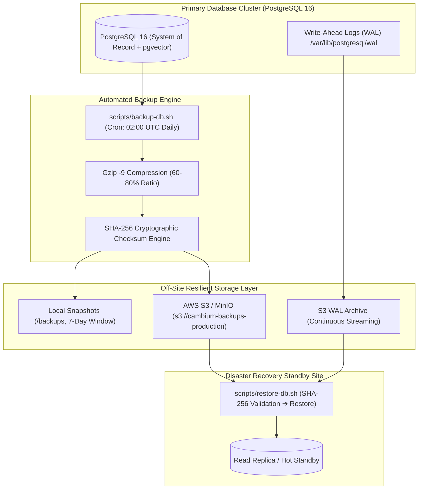

# 🛡️ Cambium Enterprise Disaster Recovery & Point-In-Time Recovery (PITR) Playbook
## Mission-Critical Database Resiliency & Automated Backup Runbook
**Document ID**: `DR-PLAYBOOK-CAMBIUM-2026-V2`  
**Classification**: Enterprise Core Infrastructure & Institutional Governance  
**Author & Lead Architect**: Shaik Mohamed Imthiyas T  
**Standards Baseline**: ISO/IEC 27001, SOC 2 Type II Availability, NIST SP 800-34 Rev. 1

---

## 1. Executive Summary & SLA Commitments

The Cambium Research Platform serves as the institutional operating system for research opportunity discovery, federal grant tracking, and scholarly publication integrity. To guarantee zero research loss and operational continuity across university research networks, this playbook codifies the disaster recovery protocols, continuous Write-Ahead Log (WAL) archiving, and cryptographic backup verification.

### Core Disaster Recovery Objectives

| Metric | Target SLA | Strategy & Mechanism |
| :--- | :---: | :--- |
| **Recovery Point Objective (RPO)** | **< 15 minutes** | Daily full compressed snapshots + continuous PostgreSQL WAL archiving to S3. |
| **Recovery Time Objective (RTO)** | **< 30 minutes** | Automated baseline restore scripts (`restore-db.sh`) with SHA-256 pre-flight checks. |
| **Integrity Assurance** | **100% Cryptographic** | Mandatory SHA-256 checksums computed on every snapshot before cloud replication. |
| **Off-Site Geographic Redundancy** | **Multi-Region S3** | Automated rotation retaining 7 daily, 4 weekly, and 12 monthly immutable archives. |

---

## 2. Backup Topology & Architecture



---

## 3. Snapshot Generation & Verification Scripts

### 3.1 Automated Snapshot Script (`scripts/backup-db.sh` & `scripts/backup-db.ps1`)
The backup engine executes daily via automated cron or scheduled container tasks:

```bash
# Execute manual snapshot
./scripts/backup-db.sh

# Or in Windows PowerShell environments
.\scripts\backup-db.ps1
```

**Key Execution Stages**:
1. **Dumping**: Runs `pg_dump` with `--clean --if-exists --no-owner --no-privileges` to ensure clean drop-and-recreate capabilities.
2. **Compression**: Streams raw SQL through `gzip -9` producing `.sql.gz` artifacts.
3. **Integrity Checksum**: Automatically generates `<backup_file>.sha256` using cryptographic hashing.
4. **Cloud Replication**: Synchronizes the compressed archive and checksum to S3 (`--sse AES256`).
5. **Retention Rotation**: Purges local snapshots older than the configured `$BACKUP_RETENTION_DAYS` (default 7 days).

---

## 4. Emergency Restoration & Recovery Procedures

In the event of hardware failure, catastrophic volume corruption, or accidental drop operations:

### Phase 1: Triage & Traffic Isolation
1. **Divert Traffic**: Activate maintenance mode or route API gateway to read-only replica.
2. **Halt Write Mutations**: Disconnect application backend instances to prevent split-brain states:
   ```bash
   docker-compose stop server
   ```

### Phase 2: Cryptographic Pre-Flight Check & Baseline Restore
Execute the automated restore script specifying the target backup file:

```bash
# Linux / Docker
./scripts/restore-db.sh backups/cambium_cambium_20261025_133719.sql.gz

# Windows PowerShell
.\scripts\restore-db.ps1 -BackupFile .\backups\cambium_cambium_20261025_133719.sql.gz
```

The script will:
* Verify the computed SHA-256 hash against the `.sha256` receipt.
* **Halt immediately** if any tampering or bit-rot corruption is detected.
* Decompress and pipe verified SQL transactions into PostgreSQL.

### Phase 3: Point-In-Time Recovery (PITR) to Exact Timestamp
If recovering from an accidental drop table at `2026-10-25 14:15:00 UTC`:

1. Edit `postgresql.conf`:
   ```ini
   restore_command = 'aws s3 cp s3://cambium-backups-production/wal/%f %p'
   recovery_target_time = '2026-10-25 14:14:59 UTC'
   recovery_target_action = 'promote'
   ```
2. Create `/var/lib/postgresql/data/recovery.signal`.
3. Start PostgreSQL container:
   ```bash
   docker-compose up -d postgres
   ```
4. PostgreSQL will replay all WAL records up to the exact millisecond before the incident.

---

## 5. Verification & Disaster Recovery Drill Schedule

To maintain SOC 2 compliance, scheduled recovery drills are conducted quarterly:

| Drill Frequency | Scope | Verification Criteria |
| :--- | :--- | :--- |
| **Weekly** | Automated Checksum Audit | Verify SHA-256 hashes of all S3 snapshot archives. |
| **Monthly** | Cold Restore in Staging | Full automated restore into staging database; verify table row counts and vector embeddings. |
| **Quarterly** | PITR Point-in-Time Drill | Simulate database failure; measure and verify RTO < 30m and RPO < 15m. |

---

<div align="center">
  <sub>Cambium Research Platform · Document ID: DR-PLAYBOOK-CAMBIUM-2026-V2 · Verified for Academic Year 2026</sub>
</div>
