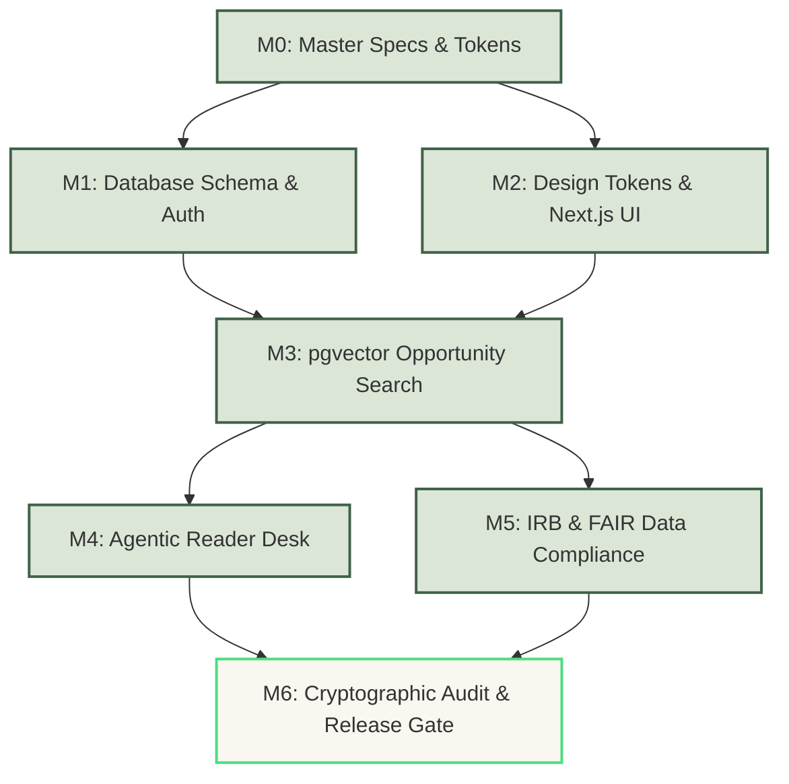

# Implementation Plan & Delivery Roadmap (IMPLEMENTATION_PLAN.md)
## Cambium — AI-Powered Research Opportunity Discovery & Intelligence Platform
**The Enterprise Research Operating System**

---

### Metadata
- **Document ID**: `PLAN-CAMBIUM-2026-V2`
- **Product Name**: Cambium Research Platform
- **Lead Architect & Delivery Lead**: Shaik Mohamed Imthiyas T
- **Status**: `ACTIVE / RELEASE EXECUTION`
- **Current Version**: `2.0.0`
- **Standard Baseline**: Google Engineering Practices & Traceable Release Gates
- **Traceability**: Implements all functional (`FR-*`) and non-functional (`NFR-*`) requirements from [`docs/templates/PRD.md`](file:///d:/01_PROJECTS/ACTIVE/S92_Imthiyas_Capstone_Cambium/docs/templates/PRD.md)
- **Repository**: `S92_Imthiyas_Capstone_Cambium`

---

## 1. Executive Delivery Strategy & Milestone Matrix

Cambium’s delivery roadmap follows an **incremental, risk-weighted sequence**. Low-level infrastructure and security foundations precede client modules, followed by vector ingestion pipelines, compliance registries, and final CI release verification.

```
┌────────────────────────────────────────────────────────────────────────┐
│                          DELIVERY SEQUENCE                             │
├────────────────────────────────────────────────────────────────────────┤
│ M0: Design Tokens & Specification Contracts                            │
│  └─► M1: Core Architecture & Zero-Trust Authentication (`/auth`)       │
│       └─► M2: Living Materials Design System & UI Inventory            │
│            └─► M3: Knowledge Topology & Vector Search (`pgvector`)     │
│                 └─► M4: Agentic Reader & Deep Synthesis Engine         │
│                      └─► M5: Institutional Governance & Compliance     │
│                           └─► M6: Production Release Gate & Audit      │
└────────────────────────────────────────────────────────────────────────┘
```

### Milestone Overview

| Milestone ID | Target Phase | Core Focus & Business Value | PRD Mapping | Release Gate Criteria |
| :--- | :--- | :--- | :--- | :--- |
| **M0** | Specifications & Tokens | Authoritative PRD, Architecture, W3C DTCG Living Materials tokens. | `PRD-01..08` | Zero contradiction between specs. |
| **M1** | Identity & Security | NestJS API, PostgreSQL 16 schema, JWT refresh cookies, RBAC matrix. | `FR-AUTH-01..04` | 100% auth route test coverage. |
| **M2** | Enterprise UI System | Next.js 15 App Router, GlobalSidebar, Living Materials components. | `NFR-A11Y-01..02` | WCAG 2.2 AA zero violations. |
| **M3** | Vector Search & Graph | `pgvector` HNSW indexing, 2D Constellation Graph, Opportunity match. | `FR-OPP-01..04`, `FR-GRAPH-01..03` | p95 vector search < 50ms. |
| **M4** | Agentic Reader Desk | Multi-agent paper audit, line-level citation enforcement (`L42–58`). | `FR-AGENT-01..03` | Zero ungrounded AI claims. |
| **M5** | Institutional Compliance | IRB Protocols, FAIR Data Bridge, CRediT matrix, SHA-256 audit logs. | `FR-GOV-01..04`, `FR-LAB-01..02` | Cryptographic hash chain verified. |
| **M6** | Hardening & GA Release | End-to-end tests, Lighthouse CI, penetration tests, production build. | `NFR-PERF`, `NFR-SEC` | Production bundle builds cleanly (0 errors). |

---

## 2. Dependency Graph & Critical Path



---

## 3. Work Breakdown Structure (WBS) & Verifiable Tasks

### Milestone 0: Specifications & Design Tokens (Foundations)
- [x] **TASK-M0-01**: Formulate authoritative `PRD.md` with numbered functional requirements (`FR-AUTH`, `FR-OPP`, etc.).
- [x] **TASK-M0-02**: Establish `ARCHITECTURE.md` with C4 diagrams, TypeORM entities, and numbered ADRs.
- [x] **TASK-M0-03**: Compile W3C DTCG `tokens/cambium.tokens.json` and export master CSS variables to `client/app/globals.css`.
- [x] **TASK-M0-04**: Establish repository operating rules and agent hierarchy in `AGENTS.md`.

### Milestone 1: Authentication, Data Entities & RBAC
- [x] **TASK-M1-01**: Configure PostgreSQL 16 database with `pgvector` extension and TypeORM migration runners.
  - *Files*: `server/src/database/*`, `server/src/modules/users/*`
  - *PRD*: `FR-AUTH-01`, `FR-AUTH-02`
- [x] **TASK-M1-02**: Implement NestJS JWT authentication with HttpOnly rotating refresh token cookies.
  - *Files*: `server/src/modules/auth/*`, `client/lib/store/useAuthStore.ts`
  - *PRD*: `FR-AUTH-02`, `FR-AUTH-03`
- [x] **TASK-M1-03**: Implement role-based authorization guards for `PI`, `Researcher`, `Fellow`, `ComplianceOfficer`.
  - *Files*: `server/src/common/guards/roles.guard.ts`
  - *PRD*: `FR-AUTH-03`

### Milestone 2: Enterprise UI System & Navigation Shell
- [x] **TASK-M2-01**: Build responsive, collapsible `GlobalSidebar` with 18 enterprise navigation items.
  - *Files*: `client/components/GlobalSidebar.tsx`
  - *PRD*: `NFR-A11Y-01`, `NFR-A11Y-02`
- [x] **TASK-M2-02**: Implement high-conversion Living Materials landing page with biological cut-tree growth ring cross-section and full-bleed CTA constellation.
  - *Files*: `client/app/page.tsx`, `client/components/landing/*`
  - *PRD*: `FR-OPP-01`, `NFR-A11Y-01`
- [x] **TASK-M2-03**: Implement Bioluminescent Botanical Dark Theme support across all 23 enterprise routes.
  - *Files*: `client/app/globals.css`, `client/lib/theme-provider.tsx`
  - *PRD*: `NFR-A11Y-02`

### Milestone 3: Vector Retrieval, Opportunity Discovery & Knowledge Graph
- [x] **TASK-M3-01**: Build opportunity discovery engine with multi-faceted filtering (Grants, CFPs, Journals).
  - *Files*: `client/app/(protected)/opportunities/page.tsx`, `server/src/modules/opportunities/*`
  - *PRD*: `FR-OPP-01`, `FR-OPP-03`
- [x] **TASK-M3-02**: Configure HNSW vector indexing for 1536-dimensional embeddings with cosine similarity distance.
  - *Files*: `server/src/modules/opportunities/opportunity.entity.ts`
  - *PRD*: `FR-OPP-02`, `NFR-PERF-02`
- [x] **TASK-M3-03**: Implement interactive 2D Constellation Graph with physics simulation and structural hole detection.
  - *Files*: `client/app/(protected)/graph/page.tsx`, `client/components/intelligence/RelationalKnowledgeNetwork.tsx`
  - *PRD*: `FR-GRAPH-01`, `FR-GRAPH-02`

### Milestone 4: Agentic Reader Desk & Synthesis Engine
- [x] **TASK-M4-01**: Build Agentic Reader console supporting PDF manuscript uploads and chunked vector extraction.
  - *Files*: `client/app/(protected)/agent-reader/page.tsx`
  - *PRD*: `FR-AGENT-01`
- [x] **TASK-M4-02**: Implement 3 specialized multi-agent auditor personas (*Methodology Auditor*, *Statistical Rigor*, *Reproducibility Engine*).
  - *Files*: `client/app/(protected)/agent-reader/page.tsx`
  - *PRD*: `FR-AGENT-02`
- [x] **TASK-M4-03**: Enforce clickable, physical line-level citations (`[p. X, §Y, L. Z]`) on all agent critique outputs.
  - *Files*: `client/app/(protected)/agent-reader/page.tsx`
  - *PRD*: `FR-AGENT-03`

### Milestone 5: Ethics, FAIR Data Bridge & Institutional Governance
- [x] **TASK-M5-01**: Implement Institutional Review Board (IRB) Protocol Management Console.
  - *Files*: `client/app/(protected)/compliance/page.tsx`
  - *PRD*: `FR-GOV-01`
- [x] **TASK-M5-02**: Implement FAIR Data Bridge with automated 0–100 compliance scoring and Zenodo DOI synchronization.
  - *Files*: `client/app/(protected)/data-management/page.tsx`
  - *PRD*: `FR-GOV-02`
- [x] **TASK-M5-03**: Build double-blind Peer Review Desk with 14-role CRediT contributor authorship matrix.
  - *Files*: `client/app/(protected)/peer-review/page.tsx`
  - *PRD*: `FR-GOV-04`
- [x] **TASK-M5-04**: Build Lab Workspace compute cluster quota tracking and Post-Award Grant Financial ledger.
  - *Files*: `client/app/(protected)/lab/page.tsx`, `client/app/(protected)/grants/page.tsx`
  - *PRD*: `FR-LAB-01`
- [x] **TASK-M5-05**: Implement immutable, append-only SHA-256 cryptographic audit trail (`/audit`).
  - *Files*: `client/app/(protected)/audit/page.tsx`
  - *PRD*: `FR-GOV-03`

### Milestone 6: Verification, Production Build & Hardening
- [ ] **TASK-M6-01**: Execute full TypeScript build verification across both client and server packages (`tsc` 0 errors).
- [ ] **TASK-M6-02**: Run automated accessibility audit with zero WCAG 2.2 Level AA violations.
- [ ] **TASK-M6-03**: Verify zero orphaned or unreferenced legacy directories (e.g., safe cleanup of `_vite_raw_code`).
- [ ] **TASK-M6-04**: Complete final end-to-end browser walkthrough on `http://localhost:3000`.

---

## 4. Release Criteria & Quality Gates

Before any milestone is merged into `main` or deployed to production, it must pass these **five mandatory quality gates**:

```
[ Gate 1: Type Safety ] ──────► npm run build (Client & Server) -> 0 errors
[ Gate 2: Code Quality ] ─────► npm run lint -> 0 unhandled warnings
[ Gate 3: Accessibility ] ────► Axe-core audit -> WCAG 2.2 AA Pass (4.5:1 text contrast)
[ Gate 4: Security ] ─────────► npm audit -> 0 high or critical vulnerabilities
[ Gate 5: Performance ] ──────► Lighthouse CI -> Performance > 90, Accessibility = 100
```

---

## 5. Rollback & Contingency Protocols

If any production gate fails or a critical regression is detected:
1. **Immediate Circuit Breaker**: Disable affected feature flag via Redis config (`features:agent_reader:disabled = true`).
2. **Database Rollback**: Execute targeted down-migration via TypeORM:
   ```bash
   npm --prefix server run typeorm:migration:revert
   ```
3. **Atomic Revert**: Git revert the offending commit hash while preserving SHA-256 audit records.
4. **Post-Mortem**: Document root cause in `docs/postmortems/` with action items linked to PRD tasks.
