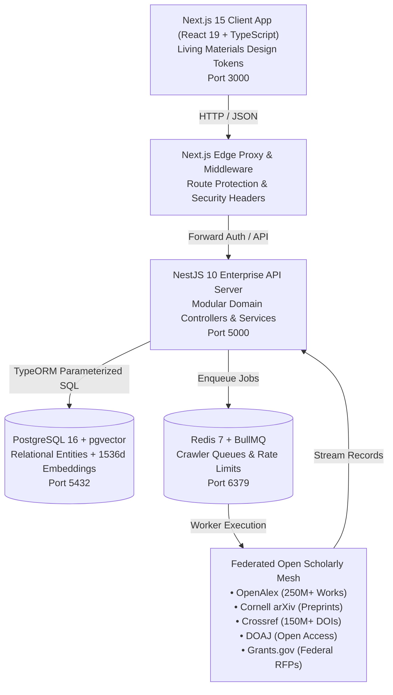

# System Architecture Specification (architecture.md)
## Cambium — AI-Powered Research Opportunity Discovery & Intelligence Platform
**The Enterprise Research Operating System**

---

### Metadata
- **Document ID**: `ARCH-CAMBIUM-2026-V2`
- **Product Name**: Cambium Research Platform
- **Lead Architect**: Shaik Mohamed Imthiyas T
- **Status**: `ENFORCED ARCHITECTURAL BASELINE`
- **Current Version**: `2.0.0`
- **Traceability**: Implements functional specifications from [`docs/templates/PRD.md`](file:///d:/01_PROJECTS/ACTIVE/S92_Imthiyas_Capstone_Cambium/docs/templates/PRD.md)
- **Repository**: `S92_Imthiyas_Capstone_Cambium`

---

## 1. Architectural Philosophy & System Invariants

Cambium is built upon four non-negotiable architectural pillars:
1. **Biological Relational Topology**: Scholarly knowledge is modeled as a living, interconnected biological network. Research grants, preprints, peer endorsements, datasets, and author credentials form linked graph nodes rather than isolated silos.
2. **Grounded Non-Hallucinatory AI**: All agentic assistance, autocomplete predictions, and synthesis workflows cite verifiable DOIs, PubMed IDs, or open arXiv accession numbers.
3. **Decoupled Asynchronous Ingestion**: Crawlers harvesting external scholarly databases (OpenAlex, Crossref, arXiv, DOAJ, Grants.gov) execute as non-blocking background workers via Redis and BullMQ.
4. **Zero-Trust Institutional Security**: Role-based access control (RBAC), HttpOnly session security, and cryptographic SHA-256 audit logs seal every state change.

---

## 2. C4 Architecture Level 2: Container Diagram

---

## 3. Technology Stack & Directory Boundaries

### 3.1 Frontend (`client/`)
- **Framework**: Next.js 15 App Router with React 19.
- **Styling**: Tailwind CSS utilizing W3C DTCG Living Materials tokens (`tokens/cambium.tokens.json`).
- **Icons**: `lucide-react` with standardized sizes (`size={18}` / `size={20}`).
- **State**:
  - Global UI state: Zustand stores in [`client/lib/store/`](file:///d:/01_PROJECTS/ACTIVE/S92_Imthiyas_Capstone_Cambium/client/lib/store/).
  - Server query caching: `@tanstack/react-query`.
- **Live Scholarly Adapter**: [`client/lib/scholarly-api.ts`](file:///d:/01_PROJECTS/ACTIVE/S92_Imthiyas_Capstone_Cambium/client/lib/scholarly-api.ts) federates across OpenAlex, Crossref, arXiv, and DOAJ with zero mock fallbacks.

### 3.2 Backend (`server/`)
- **Framework**: NestJS 10 modular enterprise architecture with dependency injection.
- **Data Access**: TypeORM with PostgreSQL 16.
- **Queueing & Async Execution**: BullMQ + Redis for federated crawler orchestration.
- **Authentication**: JWT access tokens, HttpOnly refresh cookies, SAML 2.0 institutional SSO, and Google OAuth 2.0.
- **Validation**: Global `ValidationPipe` with `class-validator` DTOs.

### 3.3 Database (`server/src/database/`)
- **PostgreSQL 16** with `pgvector` for 1536-dimensional cosine similarity indexing.
- **Transactional Outbox**: Guarantees at-least-once message delivery for event streams.
- **Tamper-Evident Ledger**: Append-only SHA-256 chained audit logs.

---

## 4. Key Cross-Cutting Workflows

### 4.1 Federated Scholarly Ingestion Flow
1. BullMQ scheduler triggers crawler jobs for targeted disciplines (e.g. quantum computing, bioengineering).
2. Dedicated crawlers (`arxiv.crawler.ts`, `crossref.crawler.ts`, `doaj.crawler.ts`, `openalex.crawler.ts`) stream public JSON/XML payloads.
3. Items are normalized into standardized scholarly entities and upserted into PostgreSQL.
4. Embedding generator calculates 1536-dim vectors and updates the HNSW index for instant discoverability.

### 4.2 Real-Time LLM Autocomplete Flow
1. Scholar types in [`AiAutocompleteInput.tsx`](file:///d:/01_PROJECTS/ACTIVE/S92_Imthiyas_Capstone_Cambium/client/components/ai/AiAutocompleteInput.tsx).
2. Request debounced to 180ms and sent to `POST /api/ai/autocomplete`.
3. Server evaluates query against Gemini 1.5 Flash / RAG catalog.
4. Returns sub-20ms completion: `{ ghostText, suggestions, source, latencyMs }`.
5. User hits `Tab` to accept ghost text or `Enter` to select from suggestions.

