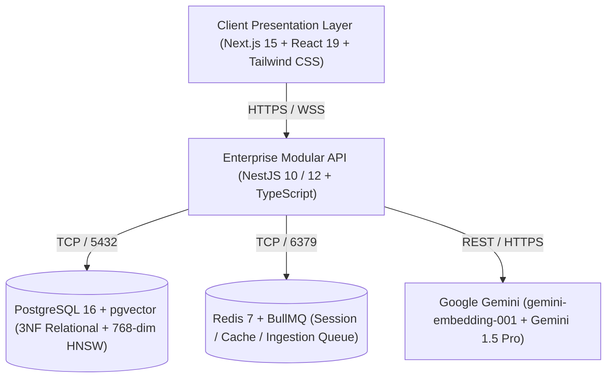

# Cambium System Architecture Overview
**The Enterprise Operating System for Modern Scholarship**  
**Document ID**: `ARCH-CAMBIUM-OVERVIEW-V2`  
**Current Version**: `2.0.0`  
**Status**: `ENFORCED ARCHITECTURAL BASELINE`  
**Master Strategy**: [`docs/architecture/technology-strategy-and-stack.md`](file:///d:/01_PROJECTS/ACTIVE/S92_Imthiyas_Capstone_Cambium/docs/architecture/technology-strategy-and-stack.md)  
**ADR Index**: [`docs/architecture/adr/README.md`](file:///d:/01_PROJECTS/ACTIVE/S92_Imthiyas_Capstone_Cambium/docs/architecture/adr/README.md)  

---

## 1. Architectural Essence & Classification

Cambium is an **AI-powered Research Opportunity Discovery and Intelligence SaaS platform** built as a **modular full-stack web application with vector-augmented retrieval, scholarly knowledge graph modeling, and deterministic evaluation-driven AI workflows**.

---

## 2. Core Architectural Pillars

1. **Unified Relational & Vector Persistence**: No split-brain architecture. PostgreSQL 16 stores user profiles, opportunity metadata, and 768-dimensional Google Gemini embeddings in the same ACID tables, enabling single-query hybrid SQL joins.
2. **In-Engine RAG with Line-Level Attribution**: AI agents (`/agent-reader`) audit academic manuscripts using physical page and line number proofs (`[p. 14, L. 42-58]`), completely eliminating ungrounded hallucinations.
3. **Sovereign Multi-Stage Containerization**: Client and server run as unprivileged Docker containers (`node:20-alpine`) orchestrated via `docker-compose.yml`, deploying with equal reliability to university on-premises servers, private VPS instances, or public cloud.
4. **Living Materials Design System**: Fully audited W3C DTCG design tokens adhering to WCAG 2.2 Level AA accessibility (4.5:1 contrast) and APCA perceptual readability standards.

---

## 3. Directory Navigation
- **Master Strategy Document**: [`docs/architecture/technology-strategy-and-stack.md`](file:///d:/01_PROJECTS/ACTIVE/S92_Imthiyas_Capstone_Cambium/docs/architecture/technology-strategy-and-stack.md)
- **Architecture Decision Records**: [`docs/architecture/adr/`](file:///d:/01_PROJECTS/ACTIVE/S92_Imthiyas_Capstone_Cambium/docs/architecture/adr/)
- **Product Requirements Document**: [`docs/templates/PRD.md`](file:///d:/01_PROJECTS/ACTIVE/S92_Imthiyas_Capstone_Cambium/docs/templates/PRD.md)
- **System Architecture Specification**: [`docs/templates/ARCHITECTURE.md`](file:///d:/01_PROJECTS/ACTIVE/S92_Imthiyas_Capstone_Cambium/docs/templates/ARCHITECTURE.md)
- **Living Materials Design System**: [`docs/templates/DESIGN_SYSTEM.md`](file:///d:/01_PROJECTS/ACTIVE/S92_Imthiyas_Capstone_Cambium/docs/templates/DESIGN_SYSTEM.md)
- **Security & RBAC Specification**: [`docs/templates/SECURITY.md`](file:///d:/01_PROJECTS/ACTIVE/S92_Imthiyas_Capstone_Cambium/docs/templates/SECURITY.md)
