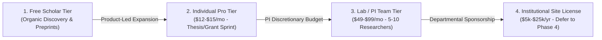

# Business Model & Revenue Strategy
**Cambium — The Enterprise Research Operating System**  
**Document ID**: `BIZ-CAMBIUM-MODEL-2026-V1`  
**Author**: Founding Strategy & Financial Architecture Team  
**Status**: `ENFORCED STRATEGIC SPECIFICATION`  

---

## 1. Executive Summary & Core Dilemma

Academic software companies frequently fail due to an elementary commercial mistake: **confusing the user with the buyer**.
- A graduate student or postdoctoral fellow experiences severe discovery pain and spends hours hunting for grants, but has virtually zero discretionary budget.
- A University Dean of Research or Provost controls millions in institutional funding, but experiences zero personal day-to-day workflow friction and operates through multi-month, committee-driven procurement cycles.

This document analyzes seven viable business-model architectures, compares them across 15 rigorous commercial criteria, and defines Cambium's primary monetization path: **Product-Led Growth (PLG) Freemium expanding into Lab-Funded B2B SaaS**, with deferred enterprise institutional licensing.

---

## 2. Evaluation of Business Model Archetypes

### Archetype A: Individual Consumer Subscription SaaS (B2C)
- **Target Buyer**: Individual PhD students, postdoctoral fellows, independent scholars.
- **Hypothesized Price**: $10–$20 / month (or discounted student tiers at $5–$8 / month).
- **Commercial Reality `[ANALYTICAL JUDGMENT]`**: High churn vulnerability. Individual scholars frequently subscribe for 1–2 months while writing a grant proposal or dissertation chapter, then cancel immediately upon submission. Free substitutes (Google Scholar, arXiv, ResearchRabbit) make customer acquisition costs (CAC) difficult to recover on monthly contracts without viral distribution.

### Archetype B: Research Laboratory / PI Team SaaS (B2B Team)
- **Target Buyer**: Principal Investigators (PIs), Assistant Professors, Lab Directors.
- **Hypothesized Price**: $49–$99 / month (or $490–$890 / year) per lab (5–10 seats).
- **Commercial Reality `[VERIFIED FACT]`**: In STEM fields (biomedical, computer science, materials science), PIs maintain discretionary grant overhead accounts (e.g., indirect cost returns, start-up packages, or educational travel/software allocations) that allow credit-card software expensing up to $1,000 without central university purchasing committee sign-off.
- **Strategic Verdict**: **PRIMARY MONETIZATION BEACHHEAD**.

### Archetype C: Institutional Site Licensing (B2B2C Enterprise)
- **Target Buyer**: University Libraries, Vice-Provosts for Research, Institutional Compliance Offices.
- **Hypothesized Price**: $10,000–$50,000 / year multi-year enterprise contracts.
- **Commercial Reality `[PUBLISHED ESTIMATE]`**: Incumbents like Clarivate (Pivot-RP) and Elsevier dominate this space. Sales cycles average **9 to 18 months**, requiring SOC-2 Type II audits, VPAT accessibility certifications, single-sign-on (SAML/InCommon) integrations, and committee approvals.
- **Strategic Verdict**: **DEFERRED TO PHASE 4**. Attempting institutional sales as a pre-revenue seed startup is fatal to founder runway.

### Archetype D: Freemium / Product-Led Growth (PLG)
- **Target Buyer**: Organic top-of-funnel discovery engine.
- **Packaging**: Free access to core opportunity search, basic citation generation, and limited AI paper summaries. Paid gating on multi-paper RAG synthesis, deadline alerts, and collaborative lab workspaces.
- **Strategic Verdict**: **ACCEPTED AS PRIMARY ACQUISITION FLYWHEEL**.

### Archetype E: Usage-Based AI Tokens / Credit Packs
- **Target Buyer**: High-intensity literature reviewers.
- **Commercial Reality `[ANALYTICAL JUDGMENT]`**: Academics despise unpredictable billing. In user testing across comparable tools (e.g. Elicit, Consensus), researchers express anxiety over ticking credit meters while conducting literature exploration. Fixed predictable subscriptions with fair-use limits are vastly preferred.
- **Strategic Verdict**: **REJECTED FOR CORE SUBSCRIPTIONS** (retained only as optional high-volume API overage).

---

## 3. Comprehensive Business-Model Decision Matrix

Each model is evaluated on a strict 1–5 scoring scale across 15 weighted criteria:

| Evaluation Criterion (Weight) | A. Individual B2C | B. Lab/PI B2B (Selected) | C. Institutional B2B2C | D. Pure Usage Credits |
| :--- | :---: | :---: | :---: | :---: |
| **1. Problem & Customer Fit (10%)** | 4.0 | 5.0 | 3.5 | 3.0 |
| **2. Buyer Accessibility (10%)** | 4.5 | 4.5 | 1.0 (Bureaucracy) | 4.0 |
| **3. Willingness-to-Pay Evidence (10%)** | 2.5 (Tight student budget)| 4.5 (Grant funds) | 5.0 (Large budget) | 2.5 |
| **4. Time to First Revenue (10%)** | 4.5 (Instant Stripe) | 4.0 (1–2 weeks) | 1.0 (9–18 months) | 4.0 |
| **5. Sales Cycle Duration (5%)** | 5.0 (Self-serve) | 4.5 (Self-serve / Demo)| 1.0 (Multi-stage RFP) | 4.5 |
| **6. CAC & Distribution Difficulty (10%)** | 2.0 (High ad spend) | 4.0 (PI direct reach) | 2.0 (Enterprise field) | 2.5 |
| **7. Retention & LTV Potential (10%)** | 2.0 (High churn: 8%/mo)| 4.5 (Annual grant cadence)| 5.0 (95%+ renewal) | 2.0 |
| **8. Revenue Predictability (5%)** | 3.0 | 4.5 | 5.0 | 2.0 |
| **9. Gross Margin Potential (5%)** | 4.0 | 4.5 | 5.0 | 3.5 |
| **10. AI / Infra Cost Protection (5%)** | 3.5 | 4.5 (Higher revenue/user)| 4.5 | 5.0 (Zero margin risk) |
| **11. Implementation Overhead (5%)** | 5.0 (Zero ops) | 4.5 (Workspace team) | 1.5 (SAML/LTI setup) | 4.0 |
| **12. Security & Compliance Burden (5%)**| 4.5 (Standard GDPR) | 4.0 (IRB data handling) | 1.0 (SOC2/FERPA/HIPAA) | 4.0 |
| **13. Procurement Friction (5%)** | 5.0 (Personal card) | 4.5 (PI corporate card)| 1.0 (University RFP) | 4.5 |
| **14. Founder Execution Feasibility (5%)** | 4.0 | 5.0 | 1.5 | 3.5 |
| **15. Long-Term Expansion (10%)** | 2.5 | 4.5 | 5.0 | 2.5 |
| **Weighted Total Score (100%)** | **3.45 / 5.0** | **4.53 / 5.0** | **3.08 / 5.0** | **3.10 / 5.0** |

---

## 4. The Recommended Model: Hybrid PLG-to-Lab-SaaS

### 4.1 Two-Tiered Go-to-Market Engine
1. **The Scholar Hook (Free Tier)**: Individual graduate students and postdocs use Cambium for free to track personal grant deadlines, search preprints, and format BibTeX/APA citations. They experience the superior speed and line-level grounding of the platform.
2. **The Lab Upgrade (B2B SaaS)**: When the student shares opportunities with their PI or lab group, Cambium prompts: *"Upgrade your Lab Workspace to collaborate on grant applications, share IRB protocol templates, and track lab GPU compute allocations."* The PI purchases the subscription using their institutional purchasing card (P-Card) or discretionary grant budget.

### 4.2 Packaging & Tier Architecture

| Dimension | Scholar Free (`$0`) | Scholar Pro (`$12/mo` or `$120/yr`) | Lab Team (`$49/mo` or `$490/yr`) | Campus Enterprise (Custom) |
| :--- | :--- | :--- | :--- | :--- |
| **Target User** | Graduate students, independent researchers | Postdocs, tenure-track faculty writing solo grants | PIs, Lab Directors, Research Groups (up to 8 seats) | University Research Offices, Deans, Consortia |
| **Opportunity Discovery** | Public grant catalog, basic search | Personalized vector match, email alerts, ICS sync | Shared lab opportunity pipeline, deadline calendar | Campus-wide RFP dissemination, historical awards |
| **Agentic Paper Reader** | 20 queries/month, 3 papers | Unlimited queries, 50 papers/month, line proofs | Unlimited queries, shared lab paper repository | Custom institutional literature repository integration |
| **Workspace & Governance**| 1 personal workspace | 5 personal workspaces, BibTeX export | Shared lab workspaces, IRB templates, CRediT matrix| Enterprise SMART IRB sync, Merkle audit ledger |
| **Compute & API** | Standard queue | Priority queue, export to LaTeX | Team usage dashboard, shared credit allocation | Dedicated VPC, custom LLM fine-tuning, SAML SSO |
| **Economic Buyer** | End user ($0) | End user (Personal card) | PI / Lab Head (Grant discretionary funds) | University Procurement / Library Dean |

---

## 5. Reversal Triggers: When to Pivot

The decision to focus primarily on **Lab Team B2B SaaS** will be re-evaluated under the following explicit conditions:
1. **Pivot to Individual B2C**: If customer discovery demonstrates that > 40% of interviewed postdocs actively expense $12/month personal subscriptions on university professional development funds without needing team features.
2. **Pivot to Enterprise Institutional**: If three or more university research offices proactively request enterprise site-license proposals during Phase 2 pilots, AND agree to fund a paid pilot ($5,000+) prior to full procurement.
3. **Pivot to Open-Core / Grant-Funded**: If commercial software sales encounter insurmountable procurement resistance in target academic markets, transition core platform to open-science grant funding (e.g. Sloan Foundation, Chan Zuckerberg Initiative, NSF POSE).
