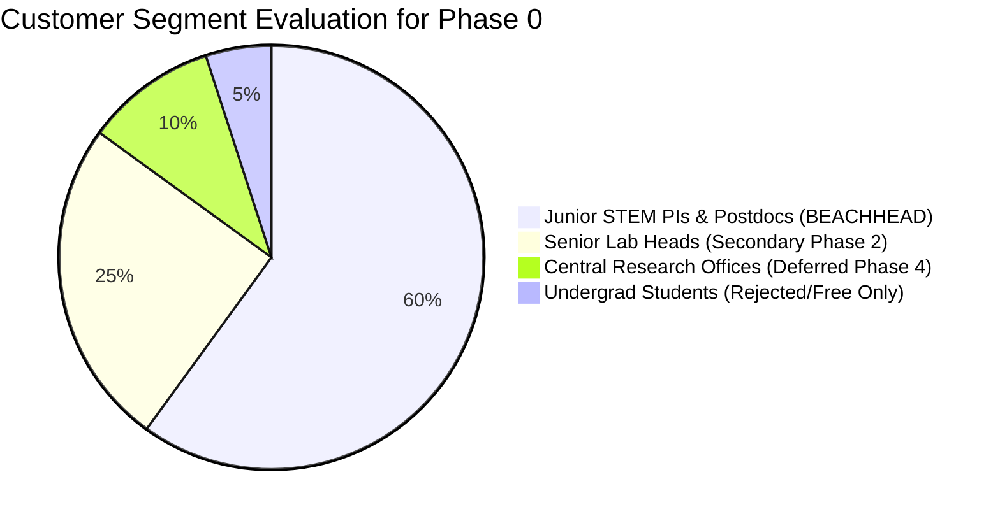

# Ideal Customer Profiles (ICP) & Customer Discovery
**Cambium — The Enterprise Research Operating System**  
**Document ID**: `BIZ-CAMBIUM-ICP-2026-V1`  
**Author**: Customer Discovery & Product-Led Growth Team  
**Status**: `ENFORCED TARGETING SPECIFICATION`  

---

## 1. Executive Summary: Selecting the Beachhead

Attempting to sell software simultaneously to undergraduate students, laboratory heads, and university provosts is a fatal startup mistake. Each possesses wildly differing budgets, purchasing authorities, and daily workflows.

Cambium selects a **single, acute beachhead customer segment**:  
🎯 **The Early-Career Academic Researcher (Postdocs & Junior Tenure-Track PIs in STEM / Life Sciences)**.

### Why This Beachhead?
1. **Urgency & Existential Stakes**: Junior faculty have 5–7 years to secure major external funding (e.g. NSF CAREER, NIH R01/K99) or face denial of tenure and career termination. The pain of missing an RFP deadline or misallocating grant writing time is visceral.
2. **Discretionary Purchasing Power**: Unlike graduate students who rely on stipends, Junior PIs control institutional start-up packages ($100k–$500k) and departmental discretionary accounts that allow expensing software under $1,000 on a university P-Card without procurement friction.
3. **High Technology Openness**: Younger researchers are enthusiastic adopters of modern AI tools (ChatGPT, Claude, Notion) but frustrated by their lack of academic rigor and hallucinated citations.

---

## 2. Exhaustive ICP Profile: Dr. Elena Rodriguez

```
┌──────────────────────────────────────────────────────────────────────────────────┐
│                   PRIMARY BEACHHEAD ICP SPECIFICATION                            │
├─────────────────────┬────────────────────────────────────────────────────────────┤
│ Persona Name & Role │ Dr. Elena Rodriguez, Assistant Professor (Tenure-Track PI) │
│ Department & Field  │ Department of Biomedical Engineering / Computational Bio   │
│ Institution Profile │ Tier-1 Research University (R1 Institution)                │
│ Lab Demographics    │ Manages 1 Lab Manager, 3 PhD Candidates, 2 Postdocs       │
│ Annual Lab Budget   │ ~$350,000 / year (Federal NIH R21 + University Startup)    │
│ Critical Career Goal│ Win NIH R01 / NSF CAREER award before Year 5 tenure review  │
└─────────────────────┴────────────────────────────────────────────────────────────┘
```

### 2.1 Jobs-to-be-Done (JTBD)
- **Primary JTBD**: *"When preparing research grant proposals, I want to automatically identify obscure, high-fit funding RFPs that match our lab's preliminary data, so that I maximize our award probability without wasting 15 hours a week scanning outdated government portals."*
- **Secondary JTBD**: *"When reviewing manuscripts drafted by my graduate students, I want to verify their methodology critiques and references against source PDFs with exact line numbers, so that our lab never submits flawed science to peer review."*

### 2.2 Current Alternatives & Friction
- **Grants.gov / NIH RePORTER**: Clunky boolean search interfaces; no semantic matching against lab papers; sends irrelevant email alerts.
- **Ex Libris Pivot-RP**: Institution has a license, but Elena finds it *"looks like it was designed in 2003"*; it is completely disconnected from where she reads papers and drafts proposals.
- **Spreadsheets & Notion**: Tracks grant deadlines manually; missed a deadline in 2025 because an NSF program officer updated the submission window on a regional PDF announcement.

---

## 3. Buyer, User & Decision-Maker Mapping

| Role Category | Individual in Lab Ecosystem | Motivation / JTBD | Authority Level | Cambium Engagement Strategy |
| :--- | :--- | :--- | :--- | :--- |
| **Primary End User** | Postdoctoral Fellow / Senior PhD Candidate | Wants literature synthesized fast; needs exact BibTeX citations. | Zero financial authority; high advocacy power. | Attract via **Scholar Free** tier; provide delightful citation & reader tools. |
| **Economic Buyer** | Junior Principal Investigator (PI) | Wants lab funded; needs students productive; fears missing grant RFPs. | **High discretionary authority** (P-Card expensing up to $1,000). | Offer **Lab Team Tier ($49/mo)** with shared workspace and grant pipeline. |
| **Budget Owner** | Department Chair / Grant Accountant | Ensures funds are spent on legitimate research/educational tools. | Approves monthly expense report receipts. | Generate automated, audited academic tax receipts with institutional PO numbers. |
| **Veto Stakeholder** | Compliance Officer / University IRB | Ensures human-subjects data is secure and ethics protocols are tracked. | Can forbid software that violates export control or HIPAA. | Highlight append-only SHA-256 audit logs and local sovereign Docker deployments. |

---

## 4. Prioritized Customer Discovery Interview Script

*Methodology: Grounded in "The Mom Test" by Rob Fitzpatrick. Never ask "Would you buy a tool that does X?". Focus 100% on past behavior, actual time spent, and historical money spent.*

### Phase 1: Context & Workflow Baseline (Minutes 0–10)
1. *"Walk me through the last grant or funding proposal your lab submitted. How did you first hear about that specific call?"*
2. *"How many hours did you personally spend searching for or evaluating grant calls over the last 30 days?"*
3. *"What specific tools, newsletters, or websites did you use to find those opportunities?"*
4. *"Can you show me the spreadsheet, calendar, or document where your lab tracks active submission deadlines?"*

### Phase 2: Friction & Cost of Failure (Minutes 10–20)
5. *"Has your lab ever discovered a grant RFP too late to submit a competitive application? What happened?"*
6. *"What is the most frustrating part of using your university’s current grant search system (e.g. Pivot-RP or Grants.gov)?"*
7. *"When your graduate students draft the background section of a paper or proposal, how do you verify that their citations actually support the scientific claims they make?"*
8. *"Have you ever tried using ChatGPT, Claude, or Elicit for literature synthesis? Where did they fall short?"*

### Phase 3: Budget & Purchasing Behavior (Minutes 20–30)
9. *"What research software did your lab purchase or expense over the past 12 months (e.g. GraphPad Prism, Overleaf, Notion, BioRender)?"*
10. *"What was the approval process to purchase that software? Did you use a university P-Card or go through central purchasing?"*
11. *"What is the dollar threshold below which you can approve a software purchase without asking your Department Chair?"*
12. *"If a software tool cost $49 a month and measurably identified one additional $100k grant RFP for your lab each year, how would you evaluate that expense?"*

---

## 5. Segment Prioritization & Deferral Rationale



### Why We Explicitly DEFER or REJECT Other Segments:
- **Undergraduate Students**: REJECTED as a paying market. High seasonal churn, zero willingness to pay, completely satisfied by free Google Scholar.
- **Central University Research Offices**: DEFERRED until Phase 4. Engaging with central procurement before Cambium has 100+ active paying faculty advocates will trap the founder in 12-month committee evaluations that kill early-stage momentum.
