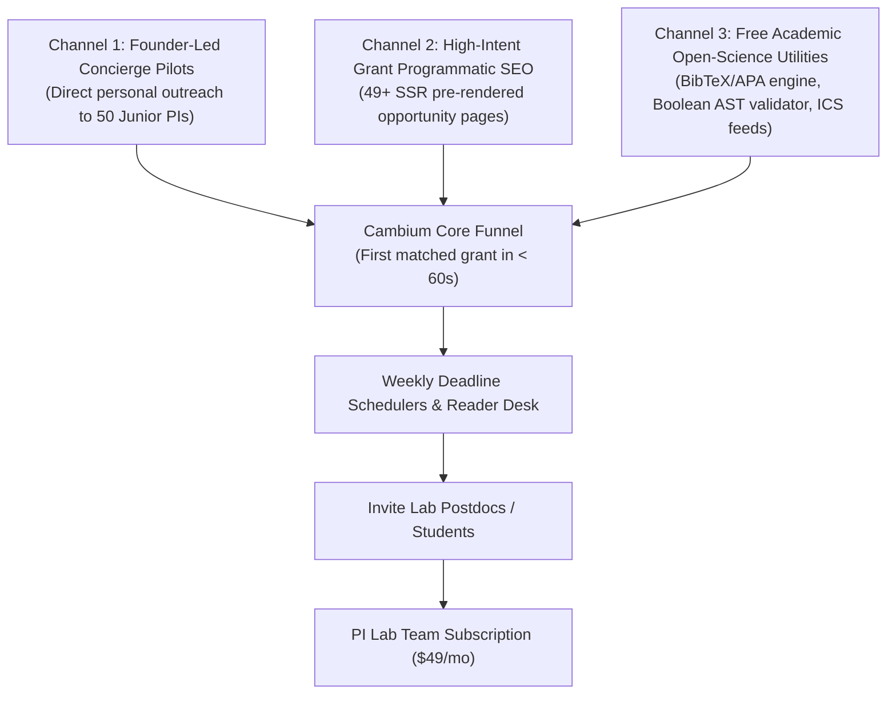

# Marketing & Growth Playbook
**Cambium — The Enterprise Research Operating System**  
**Document ID**: `BIZ-CAMBIUM-GROWTH-2026-V1`  
**Author**: Growth Marketing & Distribution Strategy Team  
**Status**: `ENFORCED GTM EXECUTION PLAN`  

---

## 1. Executive Strategy: High-Signal, Low-Budget Distribution

Academic researchers possess intense skepticism toward generic commercial advertising. Traditional B2B marketing tactics—such as unsolicited mass cold emailing, automated LinkedIn InMail spam, paid Google AdWords campaigns, and aggressive sales SDRs—consistently generate negative brand perception among university faculty.

Cambium employs an **inversion-of-control distribution model**:
$$\mathbf{Utility} \longrightarrow \mathbf{Trust} \longrightarrow \mathbf{Individual\ Habit} \longrightarrow \mathbf{Lab\ Expansion}$$

We focus on **3 high-leverage, near-zero-cash-cost acquisition channels** tailored to the academic ecosystem.

---

## 2. Top 3 Primary Initial Acquisition Channels



---

### Channel 1: Founder-Led Concierge Customer Outreach (Direct 1-on-1)
- **Target Audience**: Assistant Professors in their first 1–3 years of appointment who have recently posted on X/LinkedIn about receiving start-up funding or publishing preprints on arXiv.
- **Weekly Cadence**: 10 personalized, non-sales inquiries per week.
- **The Angle**: *"I am building open scholarly infrastructure to help junior faculty track obscure RFPs without wasting hours on Grants.gov. I noticed your recent preprint on bio-materials. Could I manually curate 5 active RFPs matching your paper in exchange for 15 minutes of candid feedback on our open-source tool?"*
- **Budget**: $0 (Founder time: 6 hours/week).
- **Target Conversion**: 50 interviews $\rightarrow$ 15 active beta users $\rightarrow$ 5 paid lab pilots.

---

### Channel 2: Programmatic High-Intent Grant & CFP SEO
- **Target Audience**: Researchers searching specific long-tail queries like:
  - *"NSF CAREER 2027 deadline eligibility requirements"*
  - *"NIH R21 computational genomics submission date"*
  - *"Bioinformatics call for papers IEEE journal 2026"*
- **Mechanism**: Next.js 15 App Router pre-renders dynamic opportunity detail routes (`/opportunities/[id]`) with semantic JSON-LD metadata (`schema.org/SpecialAnnouncement` and `schema.org/EducationalOccupationalCredential`).
- **Advantage**: Zero advertising cost. Organic Google searchers land directly on an accessible, fast-loading Cambium opportunity page with a high-conversion CTA: *"Get automated calendar alerts for this grant"*.

---

### Channel 3: Free Academic Workflow Utilities
- **Target Audience**: Graduate students and postdocs needing quick, friction-free formatting.
- **Tooling**:
  1. **Instant Citation Styler**: Standalone web tool powered by [`client/lib/citation.ts`](file:///d:/01_PROJECTS/ACTIVE/S92_Imthiyas_Capstone_Cambium/client/lib/citation.ts) (BibTeX, APA 7th, IEEE citation export with LaTeX escaping).
  2. **Boolean Query Compiler**: Visual builder powered by [`client/lib/query-parser.ts`](file:///d:/01_PROJECTS/ACTIVE/S92_Imthiyas_Capstone_Cambium/client/lib/query-parser.ts) that translates boolean rules into PostgreSQL tsquery strings.
  3. **Grant Calendar `.ics` Exporter**: One-click export syncing federal grant deadlines to Google Calendar or Apple iCal.

---

## 3. Product-Led Growth (PLG) Onboarding Funnel

To ensure high retention, the time-to-first-value (TTFV) must be **less than 60 seconds**:

```
[Step 1: Landing Page]
Scholar reviews the Living Materials homepage -> Clicks "Create research identity"
       │ (<15 seconds)
       ▼
[Step 2: Frictionless Authentication]
Scholar signs in via Google OAuth or ORCID federation (No password friction)
       │ (<10 seconds)
       ▼
[Step 3: Instant Keyword / DOI Ingestion]
Scholar inputs their ORCID or pastes 1 recent paper abstract
       │ (<5 seconds)
       ▼
[Step 4: THE 'AHA!' MOMENT (First Value)]
Cambium computes 768-dim vector embeddings and instantly presents:
"Top 3 Active Grants Matching Your Research (e.g. DARPA Biomaterials, 94% fit)"
       │ (<20 seconds)
       ▼
[Step 5: Habit Activation]
Scholar clicks "Bookmark & Schedule" -> Deadline added to personal /os calendar
```

---

## 4. Staged Go-to-Market Roadmap (Relative Timeline)

| GTM Phase | Target Timeframe | Primary Milestones & Deliverables | Exit & Gate Criteria |
| :--- | :--- | :--- | :--- |
| **Phase 0: Customer Discovery** | Weeks 1–4 | Conduct 25 Mom-Test interviews with junior PIs; validate grant tracking pain. | $\ge 15$ of 25 PIs confirm spending $>5$ hrs/mo manually tracking grants. |
| **Phase 1: Concierge Alpha** | Weeks 5–8 | Deploy closed alpha with 10 PIs; manually verify grant recommendation relevance. | Weekly Active Usage (WAU) $\ge 60\%$ across alpha cohorts. |
| **Phase 2: Design-Partner Pilots**| Weeks 9–14 | Launch 5 Lab Team pilots; introduce shared workspace & student review desk. | $\ge 3$ labs request to continue using Cambium past the 30-day pilot. |
| **Phase 3: Public Beta Launch** | Weeks 15–20| Open registration; deploy Programmatic SEO grant pages; release free citation tools.| 500 registered scholars; 50 organic opportunity bookmarks/week. |
| **Phase 4: Paid Monetization** | Weeks 21–30| Connect Stripe checkout; launch **Lab Team ($49/mo)** subscription tier. | First 10 paying Lab subscriptions ($490 MRR, $5,880 ARR). |
| **Phase 5: Scale & Referrals** | Weeks 31+ | Implement in-app lab member referral loops; initiate first university paid trials. | 50 paying Labs ($2,450 MRR, ~$29,400 ARR) with $<5\%$ monthly churn. |

---

## 5. Content Marketing & Editorial Calendar (First 8 Weeks)

| Week | Focus / Title | Primary Target Keyword | Target ICP | Distribution Channels |
| :---: | :--- | :--- | :--- | :--- |
| **W1** | *"The Junior Faculty Grant Hunt: Why Grants.gov is Costing You 15 Hours a Month"* | `academic grant search tools` | Tenure-track PIs | Substack, Academic Twitter/X, LinkedIn |
| **W2** | *"How to Audit Student Literature Reviews for Hallucinated Citations"* | `detect AI hallucinated citations` | Lab PIs, Postdocs | Reddit (`r/GradSchool`, `r/academia`), Medium |
| **W3** | *"Demystifying NSF CAREER 2027: Deadlines, Eligibility & Proposal Architecture"* | `nsf career grant deadline` | Postdocs, Junior PIs | Programmatic SEO, Academic newsletters |
| **W4** | *"The Living Materials Design System: Designing Accessible Software for Scholars"* | `academic software accessibility` | Dev community, UX | Hacker News, Dev.to |
| **W5** | *"NIH R01 vs R21: Budget Strategies, Preliminary Data & Programmatic Fit"* | `nih r01 proposal guide` | Biomedical PIs | ResearchGate, BioRxiv community |
| **W6** | *"Why We Replaced Pinecone with PostgreSQL 16 pgvector for Academic Search"* | `pgvector vs pinecone performance` | AI Engineers, CTOs | Hacker News, Twitter tech community |
| **W7** | *"Managing Lab Compute Burn Rate: A PI’s Guide to GPU Allocation for PhDs"* | `academic lab compute management` | Computer Science PIs | Twitter/X, Lab Director forums |
| **W8** | *"The FAIR Data Mandate: How to Get Your Datasets DOI-Compliant in 5 Minutes"* | `fair data principles guide` | Data Stewards, PIs | Zenodo community, University Library blogs |
