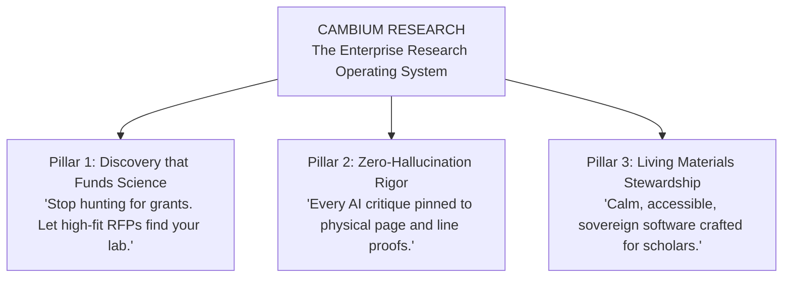

# Positioning & Messaging Architecture
**Cambium — The Enterprise Research Operating System**  
**Document ID**: `BIZ-CAMBIUM-POSITIONING-2026-V1`  
**Author**: Product Marketing & Brand Architecture Team  
**Status**: `ENFORCED COMMUNICATIONS BASELINE`  

---

## 1. Category Definition & Strategy

Choosing the correct category defines who the customer compares Cambium against and what price point they consider reasonable:

```
┌──────────────────────────────────────────────────────────────────────────────────┐
│                          CATEGORY SELECTION MATRIX                               │
├──────────────────────────┬─────────────────────────────┬─────────────────────────┤
│ Candidate Category       │ Customer Frame of Reference │ Perceived Price Anchor  │
├──────────────────────────┼─────────────────────────────┼─────────────────────────┤
│ "AI Research Assistant"  │ ChatGPT, Claude, Perplexity │ $0–$20/mo (Commodity)   │
│ "Literature Search Tool" │ Google Scholar, arXiv       │ $0/mo (Free open web)   │
│ "Grant Database"         │ Grants.gov, Pivot-RP        │ Institutional / Enterprise│
│ "Research Opportunity    │ Mission-critical workflow:  │ $49–$99/mo (Lab Team)   │
│  Intelligence System"    │ Discovery + RAG + Funding   │ $5k–$25k/yr (Campus)    │
│  (SELECTED CATEGORY)     │                             │                         │
└──────────────────────────┴─────────────────────────────┴─────────────────────────┘
```

**Strategic Verdict**: Cambium is positioned as a **Research Opportunity Intelligence System**—the Enterprise Research Operating System for Modern Scholarship.

---

## 2. Master Positioning Formula

> **For** tenure-track faculty, postdoctoral fellows, and academic research laboratories  
> **Who** struggle with fragmented grant discovery, manual deadline tracking, and ungrounded AI literature hallucinations,  
> **Cambium Research** is an AI-powered Research Opportunity Intelligence Platform  
> **That** automatically matches a researcher's published papers to high-probability global grant RFPs while providing a split-screen reading desk with line-level citation proofs (`[p. 14, L. 42–58]`),  
> **Unlike** legacy grant portals (Pivot-RP, Grants.gov) that operate as clunky 2000s-era boolean search silos, and literature tools (Elicit, Consensus) that completely ignore grant funding and institutional compliance,  
> **Cambium** unifies the entire research lifecycle—from literature gap to grant funding, IRB ethics protocols, and lab compute allocation—in a sovereign, WCAG 2.2 AA Living Materials workspace.

---

## 3. Brand Core & Messaging Pillars



### Pillar 1: Discovery that Funds Science
- **Core Message**: Research opportunities shouldn't be hidden behind twenty government portals or buried in departmental email lists.
- **Supporting Proof**: Cambium ingests and vector-indexes active opportunities across NSF, NIH, Horizon Europe, and major foundations, computing mathematical similarity against your lab's publication record using `pgvector` HNSW search.

### Pillar 2: Zero-Hallucination Academic Rigor
- **Core Message**: Generic LLMs hallucinate citations and fabricate claims. Cambium guarantees verifiable provenance.
- **Supporting Proof**: In `/agent-reader`, specialized reviewer personas (*Methodology Auditor*, *Statistical Rigor*) cite exact physical page and line numbers (`[p. 14, L. 42-58]`). If an assertion cannot be proved from the source PDF, the agent refuses to make it.

### Pillar 3: Living Materials Stewardship & Sovereignty
- **Core Message**: Scholarly tools should respect researcher cognitive health and data privacy.
- **Supporting Proof**: Engineered with W3C DTCG Living Materials design tokens passing WCAG 2.2 Level AA accessibility (APCA $L_c$ 92.4). Deployable on sovereign university Docker servers with immutable SHA-256 compliance logs.

---

## 4. Claims We CAN Make vs Claims We CANNOT Yet Make

To maintain absolute academic credibility, the founding team enforces strict marketing boundaries:

| ✅ Claims Backed by Code & Evidence | ❌ Claims Prohibited (Do NOT Make Yet) |
| :--- | :--- |
| • *"Computes semantic vector fit between publications and funding RFPs using 768-dim embeddings."* | • *"Guarantees your grant application will be funded."* (Untrue & misleading). |
| • *"Provides line-level citation proofs for extracted PDF chunks in the Agentic Reader."* | • *"Replaces human peer reviewers entirely."* (Offensive to academic peers). |
| • *"Passes WCAG 2.2 Level AA contrast standards across light and botanical dark modes."* | • *"Has 10,000 active paying university customers."* (Mock data is not actual revenue). |
| • *"Supports local, self-hosted Docker deployments with zero cloud vendor lock-in."* | • *"Full automated integration with all global university IRB software."* (In progress). |

---

## 5. Ready-to-Use Copy Inventory

### 5.1 Homepage Hero (Above the Fold)
- **Tagline Badge**: `DEMOCRATIZED SCHOLARLY ECONOMICS`
- **Headline**:  
  *Frontier AI intelligence for*  
  ***every single researcher***.
- **Sub-headline**:  
  *From early-career preprints to laboratory consortia. Discover high-fit grants, audit manuscripts down to the line number, and manage lab compliance—grounded in living science.*
- **Primary CTA**: `Create your research identity →` (Links to `/sign-up`)
- **Secondary CTA**: `Explore Open Opportunities` (Links to `/opportunities`)

### 5.2 GitHub Repository Metadata
- **Repo Name**: `kalviumcommunity/S92_Imthiyas_Capstone_Cambium`
- **Short Tagline (160 chars max)**:  
  *Cambium — The Enterprise Research Operating System. AI-powered grant opportunity discovery, line-level manuscript auditing, and institutional scholarship OS.*
- **Topics**: `research-intelligence`, `grant-discovery`, `nextjs15`, `nestjs`, `postgresql`, `pgvector`, `living-materials`, `rag`, `scholarly-infrastructure`.

### 5.3 30-Second Academic Elevator Pitch
> *"Every year, researchers spend up to 30% of their working hours manually scanning Grants.gov, university newsletters, and conference portals searching for funding. Meanwhile, generic AI tools hallucinate citations and miss the mark.  
> We built Cambium—the Enterprise Research Operating System. It automatically matches your lab’s published papers to active funding calls using vector similarity, provides a split-screen reader that audits papers down to the exact page and line number, and tracks lab compliance in one sovereign workspace."*
