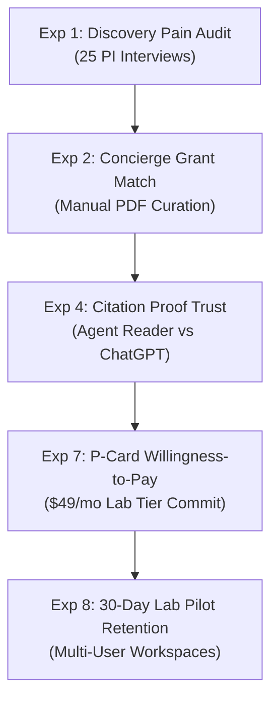
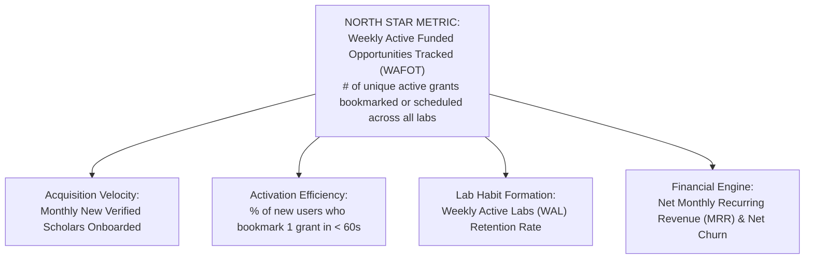

# Validation Experiments, Metrics & Pre-Mortem Analysis
**Cambium — The Enterprise Research Operating System**  
**Document ID**: `BIZ-CAMBIUM-VALIDATION-2026-V1`  
**Author**: Customer Validation, Analytics & Risk Governance Team  
**Status**: `ENFORCED EMPIRICAL EXPERIMENT PLAN`  

---

## 1. Executive Summary: Evidence Before Capital

A sophisticated strategy document is merely an unvalidated hypothesis until real customers repeatedly engage with the product and exchange money.

This document defines:
1. **10 Prioritized Validation Experiments** designed to cheaply test our riskiest commercial assumptions before writing production features.
2. **The North Star Metric** that directly reflects customer-delivered value.
3. **A Skeptical Commercial Pre-Mortem** analyzing how Cambium could fail, and how to detect early warning signals.

---

## 2. Prioritized Backlog of 10 Validation Experiments

---

### Experiment 1: Grant Discovery Time & Friction Audit
- **Hypothesis**: Junior PIs spend $> 10$ hours each month manually hunting for grants across fragmented portals and experience visceral anxiety about missing submission deadlines.
- **Riskiest Assumption**: Grant discovery is painful enough to displace established informal channels (word-of-mouth, mailing lists).
- **Methodology**: 25 one-on-one discovery interviews using "The Mom Test" script.
- **Cost / Time**: $0 / 2 Weeks.
- **Success Threshold**: $\ge 18$ of 25 PIs confirm spending $> 8$ hours/mo on grant discovery and express high frustration with existing portals.
- **Failure Threshold**: $< 10$ of 25 PIs report pain; majority state their university research office already pushes tailored opportunities to them.
- **Decision Enabled**: Validates whether Opportunity Discovery is an acute beachhead problem or merely a secondary feature.

---

### Experiment 2: Concierge Manual Grant Recommendation Test
- **Hypothesis**: If presented with 5 curated grant RFPs computed against their recent publication abstract, a researcher will bookmark at least 2 as high-priority targets.
- **Riskiest Assumption**: Algorithmic vector similarity generates grants that researchers actually find scientifically relevant.
- **Methodology**: Take 10 Junior PIs. Manually feed their publication abstracts through Cambium’s `GeminiEmbeddingService` and deliver a PDF report of top-5 matched opportunities.
- **Cost / Time**: $0 / 1 Week.
- **Success Threshold**: PIs rate $\ge 3$ of the 5 recommendations as "directly applicable to my current research trajectory."
- **Failure Threshold**: Recommendations are dismissed as "too generic" or "completely outside my discipline."
- **Decision Enabled**: Validates the precision of Cambium’s 768-dimensional vector matching engine before scaling crawlers.

---

### Experiment 3: Clickable Prototype & Aesthetic First-Impression Test
- **Hypothesis**: The W3C Living Materials design system (Parchment light, Botanical dark) communicates higher academic credibility and seriousness than generic SaaS templates.
- **Methodology**: 5-second aesthetic recall test with 20 academic researchers comparing Cambium against generic Bootstrap/Tailwind UI templates.
- **Success Threshold**: $\ge 75\%$ of researchers describe Cambium as "scholarly," "distraction-free," or "authoritative."

---

### Experiment 4: Line-Level Proof Trust vs. Generic LLM Test
- **Hypothesis**: Researchers reject generic ChatGPT summaries due to fear of hallucinated citations, but will trust Cambium’s Agentic Reader when exact line proofs (`[p. 14, L. 42-58]`) are highlighted on-screen.
- **Methodology**: Blind user testing: Present 15 researchers with two literature reviews of an arXiv paper—one generated by ChatGPT-4o and one generated by Cambium with clickable line numbers.
- **Success Threshold**: $\ge 12$ of 15 researchers choose Cambium as "safe to cite in a formal grant proposal."

---

### Experiment 5: Programmatic Grant SEO Conversion Test
- **Hypothesis**: High-intent long-tail searchers landing on pre-rendered opportunity pages (`/opportunities/[id]`) convert to free accounts at $> 5\%$.
- **Methodology**: Publish 50 static opportunity pages indexed with schema.org metadata; drive 500 organic impressions.
- **Success Threshold**: $\ge 5\%$ visitor-to-signup conversion on opportunity bookmark CTAs.

---

### Experiment 6: Free Citation Utility Viral Referral Test
- **Hypothesis**: Graduate students using the free BibTeX/APA citation formatter will share the utility with at least 1 peer within 30 days.
- **Methodology**: Add a one-click *"Share with lab group"* button upon successful citation export.
- **Success Threshold**: Viral coefficient $K \ge 0.15$ on free utility pages.

---

### Experiment 7: PI Discretionary P-Card Willingness-to-Pay Test
- **Hypothesis**: Junior PIs will commit to paying $49/month for a Lab Team subscription using their university credit card if it includes shared grant tracking for their lab.
- **Methodology**: Present 10 PIs who completed the concierge test with a Stripe pre-order checkout: *"Activate Lab Team for your group at $49/mo (30-day money-back guarantee)"*.
- **Success Threshold**: $\ge 3$ of 10 PIs enter real credit card details.
- **Failure Threshold**: Zero PIs agree to pay; state they will only use the tool if free.

---

### Experiment 8: 30-Day Lab Pilot Retention & Habit Formation
- **Hypothesis**: Labs onboarded to Cambium retain $\ge 50\%$ Weekly Active Usage (WAU) after 30 days.
- **Methodology**: Track cohort engagement across 5 pilot labs over 4 consecutive weeks.
- **Success Threshold**: PIs and lab members log in $\ge 2$ times per week to check deadlines or review papers.

---

### Experiment 9: Multi-User Lab Workspace Invite Velocity
- **Hypothesis**: A subscribing PI will invite an average of $\ge 3$ lab members within 7 days of upgrading to the Lab Team tier.
- **Success Threshold**: Mean invited members per lab $\ge 3.0$.

---

### Experiment 10: Institutional Compliance Officer Discovery
- **Hypothesis**: Central compliance officers will express interest in Cambium’s immutable SHA-256 audit logs if shown how it simplifies multi-site IRB renewal audits.
- **Methodology**: Conduct 5 exploratory interviews with university research compliance stewards.
- **Decision Enabled**: Gathers early requirements for Phase 4 enterprise site licensing without distracting from Phase 1 lab sales.

---

## 3. Metrics Architecture & North Star Metric

### The North Star Metric (NSM):
$$\mathbf{WAFOT} = \sum \text{Active Research Grants Bookmarked, Scheduled, or Exported per Week}$$

**Why WAFOT?**: Pageviews, signups, and query counts are vanity metrics. A researcher only bookmarks or schedules a grant if it has passed their intellectual filter and represents a genuine funding opportunity they intend to pursue. WAFOT directly measures value delivered to scholarship.

---

## 4. Skeptical Pre-Mortem: Why Cambium Could Fail & Mitigations

We assume it is October 2027, and Cambium has shut down. Why did it die?

| Failure Mode | Root Cause | Early Warning Signal | Pre-Emptive Mitigation |
| :--- | :--- | :--- | :--- |
| **1. The "Good Enough" Competitor** | Researchers stick with free Google Scholar + Grants.gov emails despite friction. | Low signup conversion on landing page (< 2%). | Focus messaging purely on **missed funding dollars**, not generic AI efficiency. |
| **2. Stale or Inaccurate Grant Feeds** | Crawlers fail to catch updated submission deadlines, destroying researcher trust. | User reports a dead link or expired grant. | Implement automated crawler healthcheck pings & human verification flags. |
| **3. AI Token Margin Erosion** | Power users run heavy literature syntheses that exceed subscription revenue. | Gross margin dips below 75%. | Enforce strict fair-use tier limits and route extraction queries to Gemini 1.5 Flash. |
| **4. Feature Scope Creep** | Team attempts to build an ELN, reference manager, grant writer, and peer review tool simultaneously. | High backlog items; zero features refined to excellence. | **Strictly freeze scope**: Master Opportunity Discovery & Agentic Reader before touching lab hardware. |
| **5. Procurement Death Loop** | Founder gets trapped chasing 12-month university library contracts before having revenue. | Zero revenue after 6 months; multi-stage committee meetings. | **Enforce P-Card rule**: Only sell to buyers who can swipe a credit card today ($49/mo). |
