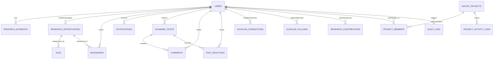

# Database Architecture & Entity Specifications (database.md)
## Cambium — AI-Powered Research Opportunity Discovery & Intelligence Platform
**The Enterprise Research Operating System**

---

### Metadata
- **Document ID**: `DB-CAMBIUM-2026-V2`
- **Product Name**: Cambium Research Platform
- **Lead Database Architect**: Shaik Mohamed Imthiyas T
- **Status**: `ENFORCED DATABASE BASELINE`
- **Current Version**: `2.0.0`
- **Primary Engine**: PostgreSQL 16.x + `pgvector` Extension
- **ORM Framework**: TypeORM 0.3.x with TypeScript Strict Mode
- **Repository**: `S92_Imthiyas_Capstone_Cambium`

---

## 1. Database Architecture Overview

Cambium utilizes **PostgreSQL 16** as its unified relational and vector data store. Rather than maintaining separate databases for tabular business data and high-dimensional vector embeddings, Cambium integrates the open-source **`pgvector`** extension directly within PostgreSQL.

### Key Architectural Advantages
1. **Single Source of Truth (SSOT)**: Relational metadata (grants, scholar profiles, peer reviews) and semantic embeddings (`vector(1536)`) reside in the same transaction boundaries.
2. **ACID Guarantees**: Opportunity updates, bookmark actions, and audit logs are committed atomically without distributed two-phase commit overhead.
3. **Transactional Outbox Pattern**: Asynchronous crawler tasks and notification dispatches write to an `outbox_events` table within the same transaction as the business entity, guaranteeing zero event loss even during worker restarts.

---

## 2. Entity-Relationship Diagram (ERD)



---

## 3. Entity Schema & Table Inventory

### 3.1 Scholar Identity & Profile Domain
- **`users`** ([`server/src/modules/users/entities/user.entity.ts`](file:///d:/01_PROJECTS/ACTIVE/S92_Imthiyas_Capstone_Cambium/server/src/modules/users/entities/user.entity.ts))
  - `id`: `UUID` (Primary Key, auto-generated)
  - `email`: `VARCHAR(255)` (Unique, Indexed)
  - `password`: `VARCHAR(255)` (Bcrypt hashed; nullable for SAML/Google SSO users)
  - `name`: `VARCHAR(120)` (Display name)
  - `role`: `ENUM ('fellow', 'researcher', 'pi', 'compliance', 'admin')`
  - `institution`: `VARCHAR(200)` (e.g. Stanford University, MIT CSAIL)
  - `department`: `VARCHAR(200)`
  - `orcid`: `VARCHAR(32)` (Unique, ISO 27729 ORCID identifier)
  - `bio`: `TEXT`
  - `avatarUrl`: `VARCHAR(500)`
  - `createdAt`, `updatedAt`: `TIMESTAMP WITH TIME ZONE`

- **`research_interests`** ([`server/src/modules/users/entities/research-interest.entity.ts`](file:///d:/01_PROJECTS/ACTIVE/S92_Imthiyas_Capstone_Cambium/server/src/modules/users/entities/research-interest.entity.ts))
  - `id`: `UUID` (Primary Key)
  - `name`: `VARCHAR(100)` (Unique, e.g. "Quantum Computing", "CRISPR-Cas9")
  - `users`: Many-to-Many join table `user_research_interests`

---

### 3.2 Opportunities & Grants Domain
- **`research_opportunities`** ([`server/src/modules/opportunities/entities/research-opportunity.entity.ts`](file:///d:/01_PROJECTS/ACTIVE/S92_Imthiyas_Capstone_Cambium/server/src/modules/opportunities/entities/research-opportunity.entity.ts))
  - `id`: `UUID` (Primary Key)
  - `title`: `VARCHAR(300)` (Indexed)
  - `description`: `TEXT`
  - `type`: `ENUM ('grant', 'fellowship', 'conference', 'scholarship', 'call_for_papers')`
  - `funder`: `VARCHAR(200)` (e.g. NSF, NIH, European Research Council)
  - `fundingAmount`: `NUMERIC(14, 2)` (Nullable, grant allocation value)
  - `deadline`: `TIMESTAMP WITH TIME ZONE` (Indexed)
  - `eligibilityCriteria`: `TEXT`
  - `sourceUrl`: `VARCHAR(500)`
  - `embedding`: `vector(1536)` (High-dimensional vector embedding for semantic search)
  - `creatorId`: `UUID` (Foreign key referencing `users.id`)
  - `tags`: Many-to-Many join with `tags` table

- **`tags`** ([`server/src/modules/opportunities/entities/tag.entity.ts`](file:///d:/01_PROJECTS/ACTIVE/S92_Imthiyas_Capstone_Cambium/server/src/modules/opportunities/entities/tag.entity.ts))
  - `id`: `UUID` (Primary Key)
  - `name`: `VARCHAR(60)` (Unique, e.g. "Artificial Intelligence", "Bioengineering")

---

### 3.3 Research Contributions & CRediT Taxonomy
- **`research_contributions`** ([`server/src/modules/contributions/entities/research-contribution.entity.ts`](file:///d:/01_PROJECTS/ACTIVE/S92_Imthiyas_Capstone_Cambium/server/src/modules/contributions/entities/research-contribution.entity.ts))
  - `id`: `UUID` (Primary Key)
  - `userId`: `UUID` (Foreign key referencing `users.id`)
  - `title`: `VARCHAR(300)` (Paper, dataset, or protocol title)
  - `doi`: `VARCHAR(100)` (Indexed official DOI)
  - `creditRole`: `ENUM` (CRediT taxonomy role: `conceptualization`, `methodology`, `software`, `validation`, `formal_analysis`, `data_curation`, `writing_original_draft`)
  - `description`: `TEXT`
  - `endorsementsCount`: `INTEGER` (Default `0`)
  - `verificationStatus`: `ENUM ('pending', 'verified', 'flagged')`
  - `createdAt`: `TIMESTAMP WITH TIME ZONE`

---

### 3.4 Academic Community & Social Graph Domain
- **`academic_posts`** ([`server/src/modules/community/entities/academic-post.entity.ts`](file:///d:/01_PROJECTS/ACTIVE/S92_Imthiyas_Capstone_Cambium/server/src/modules/community/entities/academic-post.entity.ts))
  - `id`: `UUID` (Primary Key)
  - `authorId`: `UUID` (Foreign key referencing `users.id`)
  - `content`: `TEXT`
  - `postType`: `ENUM ('discussion', 'hypothesis', 'preprint_review', 'grant_teaming')`
  - `paperDoi`: `VARCHAR(100)` (Optional paper reference)
  - `viewsCount`, `sharesCount`: `INTEGER` (Default `0`)

- **`comments`** & **`post_reactions`**
  - Threaded replies and reaction indicators (`endorse`, `question`, `bookmark`) mapped to posts and authors.

- **`scholar_connections`** & **`scholar_follows`**
  - Bidirectional mutual connection requests (`pending`, `accepted`, `rejected`) and asymmetric follower graph.

---

### 3.5 Collaborative Workspaces & Lab Projects
- **`group_projects`** ([`server/src/modules/projects/entities/group-project.entity.ts`](file:///d:/01_PROJECTS/ACTIVE/S92_Imthiyas_Capstone_Cambium/server/src/modules/projects/entities/group-project.entity.ts))
  - `id`: `UUID` (Primary Key)
  - `title`: `VARCHAR(200)`
  - `description`: `TEXT`
  - `visibility`: `ENUM ('private', 'lab_only', 'institutional', 'public')`
  - `leadScholarId`: `UUID` (Foreign key referencing `users.id`)

- **`project_members`** & **`project_activity_logs`**
  - Lab role mappings (`pi`, `lead_researcher`, `postdoc`, `student_assistant`) and timestamped workspace audit trails.

---

### 3.6 Bookmarks, Notifications & System Outbox
- **`bookmarks`**: User-saved research opportunities, grants, and indexed papers.
- **`notifications`**: User event stream (collaboration requests, deadline alerts, citation updates).
- **`audit_logs`**: Append-only cryptographic ledger with `previousHash` and `hash` fields.
- **`outbox_events`**: Guaranteed transactional message publishing queue.

---

## 4. Vector Retrieval & pgvector Configuration

Research opportunity descriptions and research interest profiles are vectorized using standard text embedding dimensions (`1536`).

### 4.1 Extension Setup
```sql
-- Ensure extension is installed
CREATE EXTENSION IF NOT EXISTS vector;
```

### 4.2 High-Speed HNSW Indexing
For sub-50ms approximate nearest neighbor (ANN) retrieval over large opportunity callsets, Cambium utilizes an **HNSW** (Hierarchical Navigable Small World) index:
```sql
CREATE INDEX IF NOT EXISTS idx_opportunities_embedding_hnsw 
ON research_opportunities 
USING hnsw (embedding vector_cosine_ops)
WITH (m = 16, ef_construction = 64);
```

### 4.3 Semantic Similarity Querying
```sql
-- Retrieve top 10 opportunities matching user research vector
SELECT 
    id, 
    title, 
    funder, 
    deadline,
    1 - (embedding <=> :targetEmbedding) AS similarity_score
FROM research_opportunities
WHERE (1 - (embedding <=> :targetEmbedding)) > 0.72
ORDER BY embedding <=> :targetEmbedding ASC
LIMIT 10;
```

---

## 5. Seeding & Database Operations

```bash
# 1. Run database migrations
npm --prefix server run typeorm:migration:run

# 2. Seed development dataset with sample grants and scholars
npm --prefix server run seed

# 3. Create fresh schema migration from entities
npm --prefix server run typeorm:migration:generate -- -n InitialSchema
```
