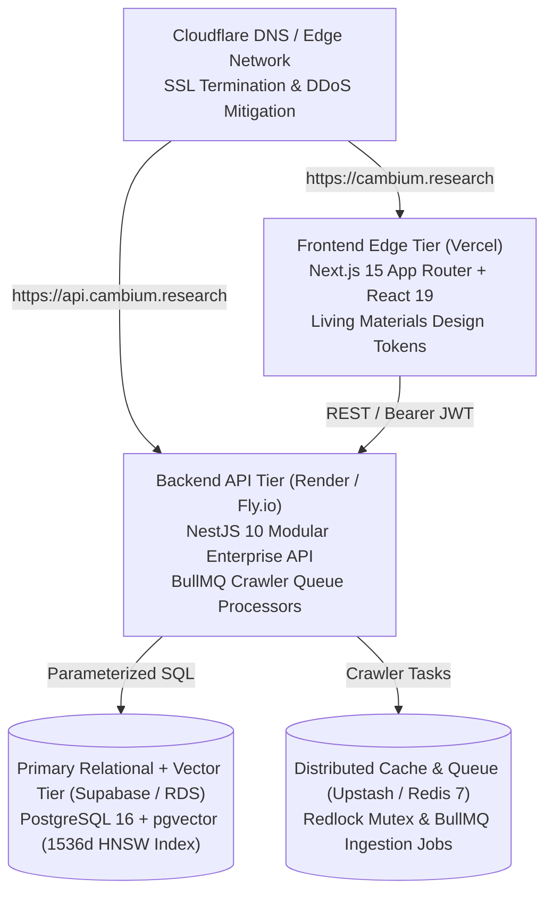

# Production Deployment & Infrastructure Runbook (deployment.md)
## Cambium — AI-Powered Research Opportunity Discovery & Intelligence Platform
**The Enterprise Research Operating System**

---

### Metadata
- **Document ID**: `DEP-CAMBIUM-2026-V2`
- **Product Name**: Cambium Research Platform
- **Lead DevOps Engineer**: Shaik Mohamed Imthiyas T
- **Status**: `ENFORCED DEPLOYMENT BASELINE`
- **Current Version**: `2.0.0`
- **Target Environments**: Docker Compose (Local / Self-Hosted) · Render (API + Redis) · Vercel (Next.js) · Supabase (PostgreSQL 16 + pgvector)
- **Repository**: `S92_Imthiyas_Capstone_Cambium`

---

## 1. Production Architecture Topology

Cambium's production stack isolates stateless application compute from persistent data engines:



---

## 2. Docker Compose Deployment (Self-Hosted / VPS)

The repository provides a unified production stack in [`docker-compose.yml`](file:///d:/01_PROJECTS/ACTIVE/S92_Imthiyas_Capstone_Cambium/docker-compose.yml):

### 2.1 Starting the Stack
```bash
# 1. Clone repository
git clone https://github.com/kalviumcommunity/S92_Imthiyas_Capstone_Cambium.git
cd S92_Imthiyas_Capstone_Cambium

# 2. Configure environment file
cp .env.example .env

# 3. Build and launch all 4 services (PostgreSQL+pgvector, Redis, API, UI)
docker-compose up --build -d

# 4. Verify service container statuses
docker-compose ps
```

### 2.2 Container Inventory
| Service Name | Container Name | Image / Base | Internal Port | Host Port | Purpose |
| :--- | :--- | :--- | :---: | :---: | :--- |
| `postgres` | `cambium_postgres` | `pgvector/pgvector:pg16` | 5432 | 5432 | Primary database & 1536d vector store |
| `redis` | `cambium_redis` | `redis:7-alpine` | 6379 | 6379 | BullMQ queues, Redlock & rate limits |
| `api` | `cambium_api` | Node.js 20 Alpine | 5000 | 5000 | NestJS 10 Enterprise API Gateway |
| `client` | `cambium_client` | Node.js 20 Alpine | 3000 | 3000 | Next.js 15 App Router Frontend |

---

## 3. Cloud Provider Deployments

### 3.1 Backend API on Render
1. Create a **Web Service** linked to this GitHub repository.
2. Configure settings:
   - **Root Directory**: `server`
   - **Build Command**: `npm install && npm run build`
   - **Start Command**: `npm run start:prod`
3. Environment variables to set:
   - `PORT`: `5000`
   - `NODE_ENV`: `production`
   - `DATABASE_URL`: `postgresql://postgres:[PASSWORD]@[HOST]:5432/cambium`
   - `REDIS_URL`: `redis://default:[PASSWORD]@[REDIS_HOST]:6379`
   - `JWT_SECRET`: High-entropy 64-character secret
   - `JWT_REFRESH_SECRET`: High-entropy 64-character secret
   - `CORS_ORIGIN`: `https://cambium.research,http://localhost:3000`
4. Health check endpoint: `/api/health`.

### 3.2 Frontend on Vercel
1. Import repository into Vercel.
2. Configure project settings:
   - **Framework Preset**: `Next.js`
   - **Root Directory**: `client`
3. Environment variables:
   - `NEXT_PUBLIC_API_URL`: `https://api.cambium.research/api`
   - `NEXT_PUBLIC_SITE_URL`: `https://cambium.research`
4. Deploy branch: `main`.

---

## 4. Post-Deployment Verification & Health Checks

Once deployed, verify system stability using automated smoke tests:

```bash
# 1. Probe backend liveness and database connection
curl -f https://api.cambium.research/api/health

# 2. Probe Prometheus operational telemetry
curl -f https://api.cambium.research/api/telemetry/metrics

# 3. Run Playwright automated smoke suite against production URL
TARGET_URL=https://cambium.research npm run test:e2e
```

