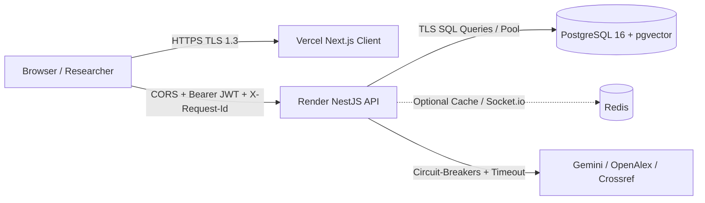
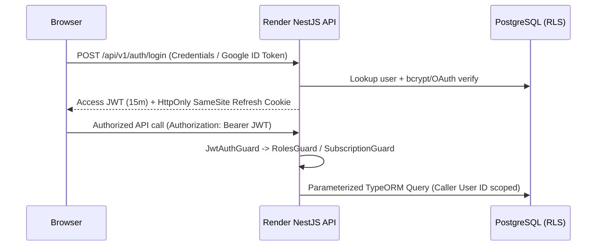
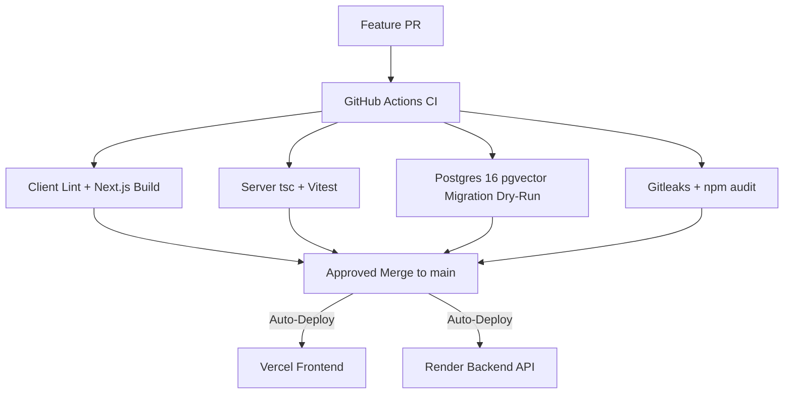
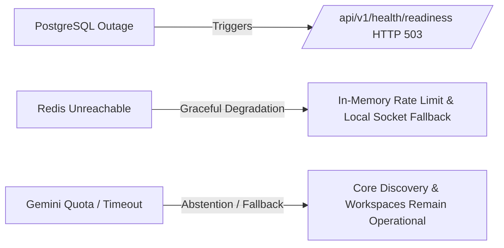

# Cambium Research — Production Infrastructure Architecture (Phase 1)

## 1. Authoritative Production Topology

Cambium operates a decoupled three-tier architecture designed for low operational overhead:

| Tier | Provider / Runtime | Role | Public Exposure |
| :--- | :--- | :--- | :--- |
| **Presentation Tier** | Vercel (`cambium-research.vercel.app`) | Next.js 16 App Router SSR + static assets + CSP security headers | **Public HTTPS** |
| **Application & API Tier** | Render (`cambium-api-ufj3.onrender.com`) | NestJS 10 REST/WebSocket/SSE server, TypeORM, Auth, AI orchestration | **Public HTTPS** (CORS-gated) |
| **Data & Auth Tier** | PostgreSQL 16 + `pgvector` (Managed Supabase / Render DB) | Primary relational state, RLS policies, vector similarity (`<=>`), Outbox | **Private TLS** (DB password / SSL) |
| **Cache / Adapter Tier** | Redis (`REDIS_URL`) | Optional BullMQ + Socket.io Redis adapter + rate limits (`degraded` fallback if unset) | **Private / Optional** |
| **External Providers** | Google Gemini API, OpenAlex, Crossref, arXiv, Google OAuth | Scholarly ingestion, embeddings, RAG generation, federated identity | **Outbound HTTPS** |

---

## 2. Core Architecture Diagrams

### 2.1 User Request & Data Flow

### 2.2 Authentication & Authorization Boundary

### 2.3 CI/CD Release Pipeline

### 2.4 Failure & Recovery Dependencies

---

## 3. Single Points of Failure (SPOFs) & Plan Constraints

1. **Single Render API Instance**: Current starter/free hosting runs 1 Node.js process (`cambium-api-ufj3`). Cold spin-up requires ~15–25s latency on idle wake.
2. **Primary PostgreSQL Database**: Single primary database instance; no automated failover replica provisioned on current tier (`POSTGRES_REPLICA_HOST` unused).
3. **Redis Availability**: Currently operates in `"degraded"` in-memory fallback mode when `REDIS_URL` is absent; non-critical to basic CRUD routes.
4. **Hosting Quotas**: Plan-level monthly hours, PostgreSQL connection caps, and Gemini API RPM quotas apply — exact dashboard billing usage requires manual verification (`BLOCKED` from CLI).
