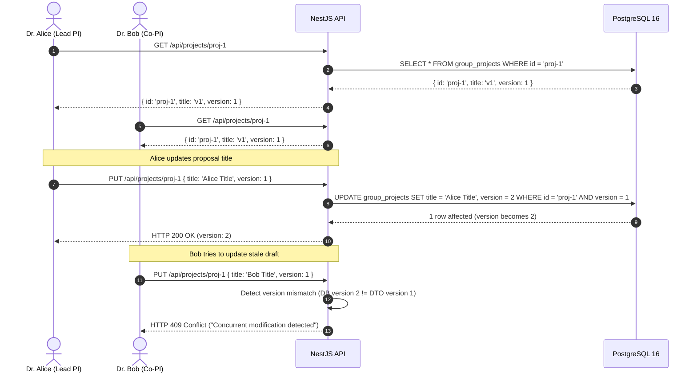

# Distributed Systems Architecture & Multi-User Isolation
## Cambium Enterprise Research Operating System
**Document ID**: `ARCH-DISTRIBUTED-SYSTEMS-2026-V1`  
**Author**: Principal Distributed Systems Architect & Staff Infrastructure Engineer  
**Date**: November 19, 2026  
**Status**: `ENFORCED SPECIFICATION`  
**Repository**: `S92_Imthiyas_Capstone_Cambium`

---

## 1. Architectural Mission & Principles

Cambium is built as a **modular monolith with enterprise distributed systems capabilities**, designed to deliver real-time, multi-tenant collaboration without unnecessary operational complexity or cloud costs (₹0 infrastructure budget).

### Core Distributed Systems Tenets
1. **Single Source of Truth**: PostgreSQL 16 is the authoritative state store. Ephemeral state (presence, typing indicators, active locks) is maintained in-memory with optional Redis pub/sub scaling.
2. **Atomic Consistency**: State mutations and domain events are bound within the same database transaction via the Transactional Outbox Pattern. Dual-write failures are architecturally impossible.
3. **Optimistic Concurrency Control (OCC)**: Workspaces, proposal sections, and research metadata use monotonic `@VersionColumn()` version tokens. Stale concurrent writes fail fast with HTTP `409 Conflict`.
4. **Zero-Trust Multi-Tenant Isolation**: Resource ownership and workspace membership are asserted on every request by NestJS guards and controller services; the frontend is never trusted for authorization.

---

## 2. Multi-User Tenancy & Data Isolation

```
+-------------------------------------------------------------------------+
|                        Institutional Boundary                           |
|  - InCommon / SAML 2.0 Identity Federation                              |
|  - Institutional ROR ID (e.g., ror.org/0428wax08 - MIT CSAIL)            |
+-------------------------------------------------------------------------+
                                    |
                                    v
+-------------------------------------------------------------------------+
|                        Workspace Boundary (Tenant)                      |
|  - GroupProject (Owner: Lead PI)                                        |
|  - Visibility: PUBLIC | LAB_ONLY | PRIVATE                              |
|  - Optimistic Lock Version: version = N                                 |
+-------------------------------------------------------------------------+
             |                                              |
             v                                              v
+-------------------------------+              +--------------------------+
|      Project Member Roster    |              |   Workspace Comments     |
| - userId, CRediTRole          |              | - authorId, sectionId    |
| - status: ACCEPTED | INVITED  |              | - isResolved, parentId   |
+-------------------------------+              +--------------------------+
```

### 2.1 Workspace Access Control Matrix
| Resource / Operation | Lead PI / Owner | Co-PI / Co-Author | Collaborator (Invited) | External Scholar |
| :--- | :---: | :---: | :---: | :---: |
| **View Public Workspace** | ✅ | ✅ | ✅ | ✅ |
| **View Private Workspace** | ✅ | ✅ (If Accepted) | ❌ | ❌ (HTTP 403) |
| **Update Metadata (OCC)** | ✅ | ✅ (If Accepted) | ❌ | ❌ (HTTP 403) |
| **Invite Collaborator** | ✅ | ✅ (If Accepted) | ❌ | ❌ (HTTP 403) |
| **Post Section Comment** | ✅ | ✅ (If Accepted) | ❌ | ❌ (HTTP 403) |
| **Resolve Comment** | ✅ | ✅ (If Accepted) | ❌ | ❌ (HTTP 403) |
| **Delete Workspace** | ✅ (Owner Only) | ❌ (HTTP 403) | ❌ | ❌ (HTTP 403) |

---

## 3. Optimistic Concurrency Control (OCC)

To prevent simultaneous edits from overwriting each other, `GroupProject` incorporates TypeORM's `@VersionColumn({ name: 'version', default: 1 })`.

### OCC Flow Diagram


When Bob receives `HTTP 409 Conflict`, the client fetches the latest server revision and displays a diff resolution dialog rather than corrupting Alice's changes.
