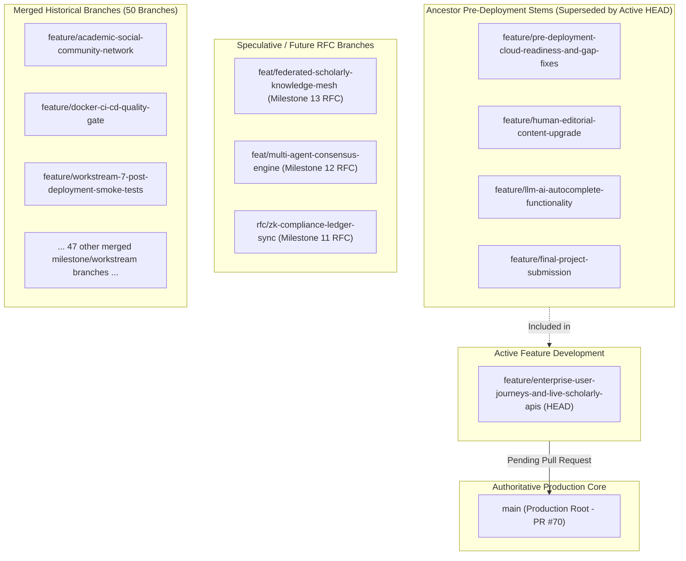

# Cambium Branch & Pull Request Governance Review
## Master Git Branch Classification, Merge Traceability & Hygiene Audit
**Document ID**: `GIT-CAMBIUM-HYGIENE-2026-V1`
**Repository**: `kalviumcommunity/S92_Imthiyas_Capstone_Cambium`
**Auditor**: Repository Governance Maintainer & Staff DevOps Engineer
**Status**: `VERIFIED AUDIT REPORT — PENDING HUMAN ACTION`
**Evaluation Date**: November 2026

---

## 1. Branch Classification & Status Overview

A comprehensive audit of the Git tree identified **58 local branches** and **51 remote tracking branches**. The branch taxonomy is classified as follows:



---

## 2. Detailed Branch Inventory & Recommendations

### Category 1: Authoritative Production Branch (PROTECTED)
- **`main`**: The canonical production branch. Contains all merged deliverables through PR #70 (`c944733`).
- **Action**: **DO NOT DELETE**. Requires manual GitHub branch protection enablement.

---

### Category 2: Active Development Branch (CURRENT HEAD)
- **`feature/enterprise-user-journeys-and-live-scholarly-apis`** (Local & Remote):
  - **Status**: **ACTIVE / WORKING HEAD**.
  - **Contains**: 11 unmerged commits ahead of `main`:
    - `b99bbb4`: chore: normalize trailing newlines across client metadata, layouts, and public assets
    - `dda399e`: feat(prod-readiness): complete production readiness uplift across metadata, SEO, defensive layout, and session lifecycle
    - `d8684af`: docs: author authoritative security, code-style, database, api-guide, architecture, and testing documentation
    - `059f66d`: feat(scholarly): integrate DOAJ open access crawler and wire dynamic user research interests into discover and dashboard rails
    - `93e510d`: fix(brand): mathematically and optically center spiral logo mark and harden enterprise user journeys with live scholarly APIs
    - `eedde30`: feat(deploy): resolve pre-deployment gaps, eliminate hardcoded hosts, configure cloud manifests, and align rubric
    - `b62d423`: style(ui): polish discover search bar into seamless borderless pill and eliminate box outline
    - `5a62142`: feat(editorial): complete 100% human-owned product content overhaul and anti-ai-slop cleanup across all routes
    - `46887c7`: docs: prepare final project submission and technical documentation
    - `8093f93`: fix(ui): polish research inbox layout, anchor message attachment flyout, and circular upload orb
    - `83548d7`: feat(ai): implement real-time LLM autocomplete functionality, ghost-text engine, and copilot studio
  - **Action**: **KEEP**. This branch represents the active deliverable ready for final Pull Request and merge into `main`.

---

### Category 3: Ancestor Pre-Deployment Branches (Superseded by Active HEAD)
The following 4 branches represent progressive commits that are **fully included** within the current active branch `feature/enterprise-user-journeys-and-live-scholarly-apis`:

| Branch Name | Latest Commit Included in Active HEAD? | Safe to Clean Locally? | Remote Status |
| :--- | :--- | :--- | :--- |
| `feature/pre-deployment-cloud-readiness-and-gap-fixes` | **Yes** (`eedde30` is ancestor of HEAD) | **Yes** (After PR merge) | Candidate for deletion |
| `feature/human-editorial-content-upgrade` | **Yes** (`5a62142` is ancestor of HEAD) | **Yes** (After PR merge) | Candidate for deletion |
| `feature/llm-ai-autocomplete-functionality` | **Yes** (`83548d7` is ancestor of HEAD) | **Yes** (After PR merge) | Candidate for deletion |
| `feature/final-project-submission` | **Yes** (`46887c7` is ancestor of HEAD) | **Yes** (After PR merge) | Candidate for deletion |

---

### Category 4: Speculative Future Milestone / RFC Branches
These branches contain conceptual commits for speculative post-v2.0 milestones. They are **not merged** into `main` and should be retained for future reference:

| Branch Name | Purpose | Action |
| :--- | :--- | :--- |
| `feat/federated-scholarly-knowledge-mesh` | Milestone 13: Cross-university federated knowledge fabric. | **Retain as archive branch**. |
| `feat/multi-agent-consensus-engine` | Milestone 12: Multi-agent consensus & peer review arbitration. | **Retain as archive branch**. |
| `rfc/zk-compliance-ledger-sync` | Milestone 11: Zero-knowledge institutional compliance proofs. | **Retain as archive branch**. |
| `feature/mock-ux-design` | Early course milestone: Mock UX design link. | **Retain or delete upon human approval**. |
| `feature/react-app-init` | Early course milestone: Initial React app commit. | **Retain or delete upon human approval**. |

---

### Category 5: Merged Historical Branches (Verified Fully Merged into `main`)
The following **50 branches** have their full commit history merged into `origin/main` (verified via `git branch --merged main`). They are technically obsolete and safe to prune locally:

<details>
<summary>Click to view all 50 verified merged branches</summary>

1. `bugfix-localhost-stability`
2. `feature/academic-social-community-network`
3. `feature/auth-implementation`
4. `feature/bruno-api-docs`
5. `feature/database-read-write`
6. `feature/database-schema`
7. `feature/docker-ci-cd-quality-gate`
8. `feature/dockerfile-support`
9. `feature/dsa-inverted-index-and-gemini-rag`
10. `feature/entity-relationship`
11. `feature/evidence-based-research-contributions`
12. `feature/file-upload`
13. `feature/file-upload-ingestion`
14. `feature/frontend-ui-workflow`
15. `feature/full-site-i18n-continuity`
16. `feature/get-api-implementation`
17. `feature/google-auth`
18. `feature/jest-unit-testing`
19. `feature/jwt-auth`
20. `feature/lightning-navigation-velocity`
21. `feature/live-scholarly-data-fabric`
22. `feature/milestone-10-enterprise-security-trust`
23. `feature/milestone-6-hardening-verification`
24. `feature/milestone-9-scholar-identity-cadence`
25. `feature/monthly-separated-honeycomb-cadence`
26. `feature/open-scholarly-live-api`
27. `feature/post-api-implementation`
28. `feature/production-secrets-vault-and-env-hardening`
29. `feature/put-api-implementation`
30. `feature/react-component-development`
31. `feature/readme-setup`
32. `feature/repo-architecture-and-structure-polish`
33. `feature/scholarly-google-search-boxes`
34. `feature/update-delete-functionality`
35. `feature/workstream-4-postgres16-pgvector-provisioning`
36. `feature/workstream-5-reverse-proxy-and-edge-routing`
37. `feature/workstream-6-process-supervision-and-backup-automation`
38. `feature/workstream-7-post-deployment-smoke-tests`
39. `fix/client-hydration-and-theme-resilience`
40. `refactor/ssot-architecture-overhaul`
41. `repo-hygiene-and-readme-polish`
42. `setup-readme`
43. `sprint-a-observability`
44. `sprint-b-disaster-recovery`
45. `sprint-c-e2e-and-accessibility`
46. `stage-1-frontend`
47. `stage-2-backend`
48. `stage-3-database`

</details>

---

## 3. Pull Request Review & Recommendation

### Active PR to Review & Merge
- **Branch**: `feature/enterprise-user-journeys-and-live-scholarly-apis`
- **Target**: `main`
- **Comparison Link**: `https://github.com/kalviumcommunity/S92_Imthiyas_Capstone_Cambium/compare/main...feature/enterprise-user-journeys-and-live-scholarly-apis?expand=1`
- **Scope**:
  - Full production readiness uplift across metadata, SEO, defensive typography, and session lifecycle.
  - Complete documentation suite (Architecture, Security, Database, API Guide, Testing, Deployment).
  - OpenAlex and DOAJ open-access scholarly API integration.
  - Mathematical optical centering of botanical spiral logo mark.
  - Discover search bar polish (eliminated inner box outline).
- **Recommendation**: Review and merge as the definitive v2.0.0 Capstone deliverable.

---

## 4. Safe Cleanup Protocol (Commands for Human Execution)

To preserve all uncommitted and remote work, AI agents **do not** automatically delete remote branches. Once the active PR is merged into `main`, the repository maintainer can run these safe cleanup commands:

```bash
# 1. Checkout main and pull latest merged changes
git checkout main
git pull origin main

# 2. Prune local references to deleted remote branches
git fetch --prune

# 3. Safely delete local branches that are confirmed merged into main
git branch --merged main | grep -v '^\*' | grep -v 'main' | xargs -r git branch -d
```

