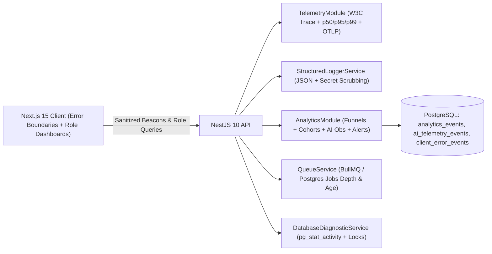

# Cambium Research — Three-Layer Analytics & Observability Architecture

## 1. System Diagram

## 2. Trust Boundaries & Operational Isolation

1. **Free-First Self-Contained Storage**: All telemetry & analytics persist directly inside PostgreSQL (`analytics_events`, `ai_telemetry_events`, `client_error_events`) and process memory (`TelemetryService`), introducing `$0` recurring vendor SaaS fees and zero third-party subprocessor sharing.
2. **Role-Gated Intelligence Access**: Metrics and dashboard routes (`/api/telemetry/*`, `/api/v1/analytics/dashboards/*`) are guarded strictly by `JwtAuthGuard` + `RolesGuard` (`SuperAdmin`, `RDDirector`, `UniversityLeadership`, `ComplianceOfficer`, with institutional dashboards strictly tenant-scoped by `organizationId` and `>= 3` cohort minimums).
3. **Resilience Guarantee**: Every domain emitter catches storage failures locally and logs a warning via `StructuredLoggerService`, preventing telemetry degradation from causing HTTP `500` errors on scholarly endpoints.
