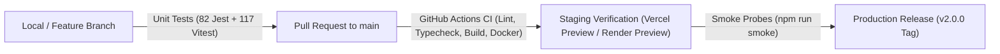

# Cambium Release Management & Versioning Protocol
## Enterprise Release Engineering, Semantic Versioning & Gate Verification
**Document ID**: `REL-CAMBIUM-OPS-2026-V1`
**Repository**: `kalviumcommunity/S92_Imthiyas_Capstone_Cambium`
**Auditor**: Principal Architect & DevOps Engineer
**Status**: `ENFORCED OPERATIONAL RUNBOOK`

---

## 1. Versioning Strategy: Semantic Versioning (SemVer 2.0.0)

Cambium strictly adheres to Semantic Versioning (`MAJOR.MINOR.PATCH`):

$$\mathbf{Version} = \mathbf{MAJOR} \cdot \mathbf{MINOR} \cdot \mathbf{PATCH}$$

- **`MAJOR` (e.g. 2.0.0 $\rightarrow$ 3.0.0)**: Incompatible schema migrations, breaking API contract changes, or architectural overhauls.
- **`MINOR` (e.g. 2.0.0 $\rightarrow$ 2.1.0)**: Backward-compatible functionality additions (new scholarship crawlers, UI routes, export formats).
- **`PATCH` (e.g. 2.0.0 $\rightarrow$ 2.0.1)**: Backward-compatible bug fixes, performance optimizations, or security patches.

---

## 2. Release Cadence & Environment Progression



---

## 3. Pre-Release Verification Checklist

Before publishing any release or tag:

### Gate 1: Code Quality & Type Safety
```bash
# Frontend type check & build
npm --prefix client run build

# Backend compilation & type check
cd server && npm run build
```
- **Criterion**: Exit code 0, 0 TypeScript compiler errors.

### Gate 2: Automated Test Suites
```bash
# Execute Jest unit test suite (82 tests)
npm run test:jest

# Execute Vitest backend test suite (117 tests)
npm --prefix server run test
```
- **Criterion**: 100% test pass rate across all 33 test files (199 total unit tests).

### Gate 3: Infrastructure & Environment Integrity
```bash
# Verify environment variable configurations
npm run verify:env

# Verify database connectivity and schema readiness
npm run verify:db
```

### Gate 4: Security & Secrets Hygiene
- Verify that `.env` and sensitive credentials are not committed.
- Verify `git status` shows zero tracked `.sql.gz` or credentials.

---

## 4. Release Tagging & Publication Procedure

Once all 4 verification gates pass:

```bash
# 1. Update version in root, client, and server package.json manifests
# (e.g. v2.0.0)

# 2. Commit the version bump and updated CHANGELOG.md
git add package.json client/package.json server/package.json CHANGELOG.md
git commit -m "chore(release): prepare v2.0.0 enterprise release"

# 3. Create an annotated and signed Git tag
git tag -a v2.0.0 -m "Release v2.0.0 — Enterprise Research Operating System GA"

# 4. Push branch and tags to remote
git push origin main
git push origin v2.0.0
```

---

## 5. Rollback & Hotfix Procedure

In the event of an unhandled production regression:

1. **Immediate Traffic Divert**:
   - Revert edge DNS or roll back deployment commit in Vercel / Render dashboard (< 60 seconds).
2. **Hotfix Branch Creation**:
   ```bash
   git checkout -b hotfix/v2.0.1 v2.0.0
   ```
3. **Targeted Fix & Verification**:
   - Apply patch, run unit tests, and tag `v2.0.1`.
4. **Post-Mortem**:
   - Document root cause in `docs/operations/incident-reports/`.

