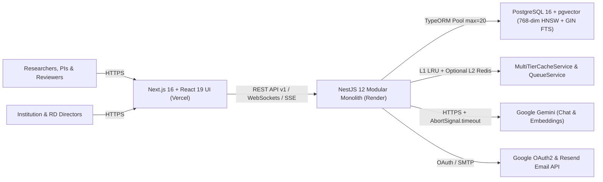
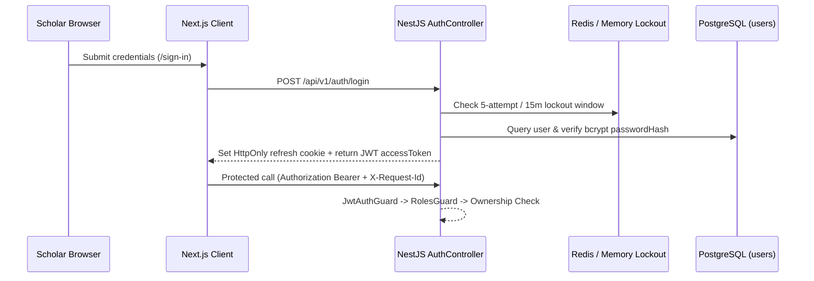
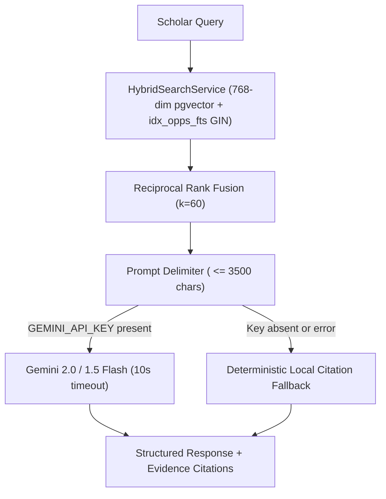

# Cambium Research — System Overview, Context & Runtime Architecture

**Status Legend:** `VERIFIED` (inspected & compiled/tested in repo) · `PARTIALLY VERIFIED` (runtime fallback active locally; cloud credentials optional) · `PLANNED` (deferred to subsequent release/design programs)

---

## 1. Product Purpose & Boundaries

Cambium Research is an **Enterprise Research Operating System** helping scholars, labs, and institutional research offices discover opportunities, organize collaborative workspaces, manage scholarly artifacts, and synthesize cross-disciplinary evidence.

### Capabilities & Verification Matrix

| Area | Capabilities on `main` | Status |
| :--- | :--- | :--- |
| **Opportunity Discovery** | Filterable catalog (`Grant`, `CFP`, `Journal`, `Paper`), deadlines, tags, GIN full-text + `pgvector` HNSW hybrid RRF search, bookmarks | `VERIFIED` |
| **Scholar Identity & RBAC** | Email/password auth with JWT + HttpOnly refresh cookies, 10-role RBAC enum (`SUPER_ADMIN` to `EXTERNAL_REVIEWER`), Google OAuth, InCommon/SAML 2.0 SSO stub/metadata flow | `PARTIALLY VERIFIED` (SAML defaults to test IdPs when `SAML_CERT` is unset) |
| **Collaborative Workspaces** | `GroupProject` creation, `ProjectMember` CRediT roles, activity logs, comments, Socket.IO real-time updates, transactional outbox relay | `VERIFIED` |
| **Document Upload & OCR** | 50MB artifact cap, SHA-256 hashing, magic-byte validation, worker-thread / sandboxed fallback PDF text/table extraction | `VERIFIED` |
| **AI & RAG Assistant** | `AssistantService` (`gemini-2.0-flash` + deterministic offline fallback), `gemini-embedding-001` (`768`-dim), prompt injection delimiting (`<untrusted_source_data>`) | `PARTIALLY VERIFIED` (Deterministic fallback runs when `GEMINI_API_KEY` is absent) |
| **Institutional Research OS** | `Organization`, `Department`, `Proposal`, `FundingAccount`, `BudgetLineItem`, `ExpenseRequest`, `ComplianceProtocol`, cross-tenant isolation guards | `VERIFIED` |
| **Analytics, Observability & UI Accessibility Polish** | Performance/QA/Privacy/Analytics programs developed on stacked feature branches; Accessibility + Design System unification deferred to Program 14 | `PLANNED` (awaiting consolidated release integration) |

---

## 2. System Context & Container Architecture

---

## 3. Core Runtime Lifecycles

### Authentication & Authorization Flow

### AI / RAG Query Flow

