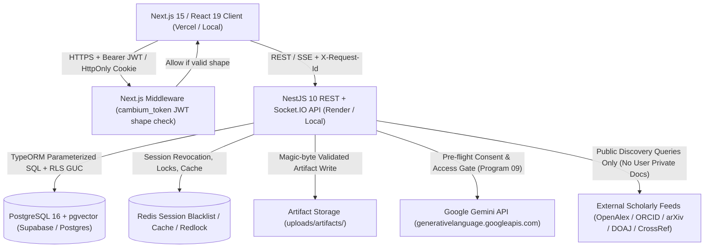

# Cambium Research — System Data Flow Map

## 1. End-to-End Flow Architecture

## 2. Boundary & Transmission Summary

1. **Client -> Next.js Middleware**: Evaluates `cambium_token` JWT shape/expiration only; no secret PII is placed into redirect URLs (`sanitizeInternalRedirect`).
2. **Client -> NestJS Backend**: Credentials travel over TLS/HTTPS; refresh tokens use `HttpOnly` cookies (`cambium_refresh_token`, path `/api`); local demo tokens are restricted strictly to offline fallback UX when configured.
3. **NestJS -> PostgreSQL / Supabase**: Relational persistence with `001_supabase_rls_lockdown.sql` enforcing RLS across 33 application tables, expanded in Program 09 via `002_privacy_governance_tables.sql`.
4. **NestJS -> Google Gemini API**: Outbound network crossing outside self-hosted/database boundary whenever `GEMINI_API_KEY` is configured and called (`AssistantService`, `GeminiEmbeddingService`, `LlmAutocompleteService`). **Invariant**: Private research artifacts MUST pass workspace/owner authorization and explicit AI-processing consent before crossing this boundary.
5. **NestJS -> Scholarly APIs**: Outbound queries search public works/grants by keywords, DOIs, or user-initiated ORCID lookup (`orcid-api.ts`); confidential draft manuscripts are never transmitted to public catalog crawlers.
