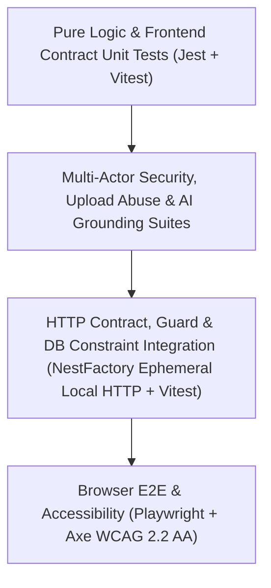

# Cambium Test Architecture & Pyramid (Phase 1)

| Layer | Runner & Location | What It Proves |
| :--- | :--- | :--- |
| **Frontend / Pure Unit** | `npm run test:jest` (`tests/unit/*.spec.ts`) | Zod validation schemas, Next.js middleware redirect sanitization, citation formatters, boolean AST, offline sync, client RAG grounding |
| **Backend Unit & Security** | `cd server; npm test` (`server/src/**/*.spec.ts`) | Service domain rules, multi-actor RBAC/IDOR, SSRF, SQL RLS static/AST checks, cache singleflight, queue deduplication |
| **Real HTTP Pipeline Integration** | `server/src/qa/*.spec.ts` (booting real Nest `ValidationPipe` + Express on `127.0.0.1:0`) | Actual HTTP wire status codes (`400`, `401`, `403`, `404`, `503`), `forbidNonWhitelisted`, `ParseUUIDPipe`, JSON contract shapes |
| **Browser E2E & A11y** | `npm run test:e2e` (`tests/e2e/*.spec.ts`) | Edge middleware redirects, authenticated journeys, Axe WCAG AA critical checks, mobile/desktop viewports |
