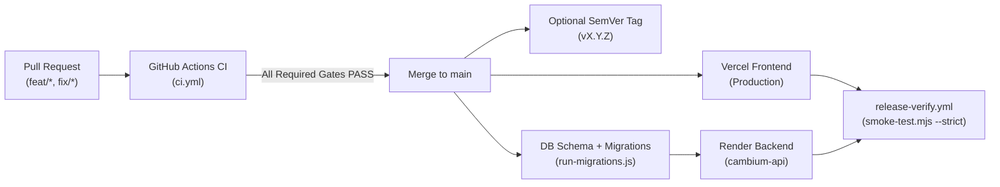

# Cambium Release Architecture

**Document ID**: `REL-ARCH-2026-V1`  
**Owner**: Release Engineering & Platform Operations  

## 1. Platform Deployment Topology

Cambium operates a decoupled SaaS architecture across four managed control planes:

| Layer | Technology | Hosting / Control Plane | Deployment Trigger |
| :--- | :--- | :--- | :--- |
| **Source Control & CI** | GitHub Monorepo (`client/`, `server/`, `tests/`, `scripts/`) | GitHub (`origin` & `personal` remotes) | Push / Pull Request to `main` |
| **Frontend Web App** | Next.js 16 (App Router) + React 19 | Vercel (`client/vercel.json`) | Auto-deploy from `main`; Preview deploys on PRs |
| **Backend API** | NestJS 12 + Express 5 + Socket.io | Render (`render.yaml`, `cambium-api`) | Controlled deploy from `main` after CI passes |
| **Database & Vector Store** | PostgreSQL 16 + `pgvector` + RLS | Supabase / Render Postgres | Versioned SQL via `schema:apply` + `migrate:up` |

## 2. End-to-End Release Flow

## 3. Compatibility Principle

Frontend (Vercel) and Backend (Render) deploy independently on separate control planes. Therefore:
1. API changes must preserve backward compatibility across at least one release cycle.
2. Database schema changes must follow expand-and-contract ordering (`database-release-policy.md`).
3. Release revision identity is surfaced via `GET /health` (`version` + `gitSha`).
