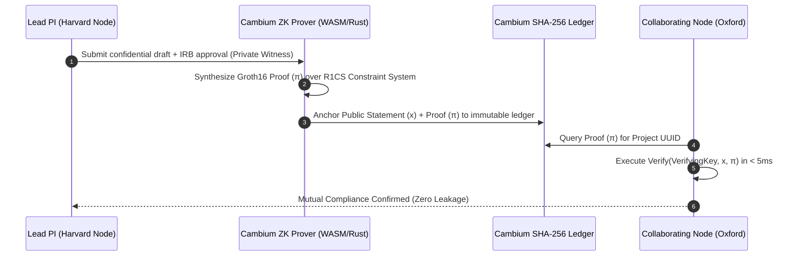

# RFC-001: Zero-Knowledge Compliance Proofs & Federated Institutional Ledger Sync
## Cambium Research Platform — Architectural RFC (Milestone 11)

---

### RFC Metadata
- **RFC ID**: `RFC-CAMBIUM-2026-001`
- **Title**: Zero-Knowledge Compliance Proofs & Inter-University Ledger Sync
- **Status**: **DRAFT / OPEN FOR ARCHITECTURAL DECISION**
- **Target Milestone**: Milestone 11
- **Author**: Cambium Principal Security & Cryptography Architecture Board

---

## 1. Problem Statement & Motivation

Modern scholarship frequently involves high-stakes multi-institutional grants (NIH R01, Horizon Europe, DARPA). While participating universities (e.g. Harvard, Oxford, Max Planck) must verify that collaborator research teams meet strict ethics compliance (IRB human subjects protocols, export controls, dual-use research of concern, financial conflict-of-interest declarations), institutions **cannot legally or ethically disclose the raw proposal drafts or confidential research data** prior to formal publication or patent filing.

Today, this requires weeks of opaque manual legal attestation via signed PDF affidavits. Cambium proposes an automated **Zero-Knowledge Succinct Non-Interactive Argument of Knowledge (zk-SNARK)** architecture to cryptographically prove compliance without disclosing sensitive research payloads.

---

## 2. Proposed Architecture & Mathematical Formulation

$$\pi = \text{Prove}_{\text{zk}}(\text{ProvingKey}, \vec{x}_{\text{public}}, \vec{w}_{\text{private}})$$

$$\text{Verify}_{\text{zk}}(\text{VerifyingKey}, \vec{x}_{\text{public}}, \pi) \in \{0, 1\}$$

- **Public Inputs ($\vec{x}$)**: Funder identifier (e.g. `NIH-R01-2026`), compliance criterion hash (`SHA-256(IRB_CRITERIA)`), expiration timestamp, and university cryptographic public key.
- **Private Witness ($\vec{w}$)**: Complete proposal draft, participant identities, and raw institutional approval certificate.
- **Output Proof ($\pi$)**: A succinct ~128-byte Groth16 cryptographic proof verifying that the private proposal strictly satisfies all funder rules without exposing a single word of the text.

---

## 3. Critical Architectural Decisions Requiring Alignment

### Decision 1: Prover Runtime Topology
- **Option A (In-Process WASM)**: Execute Circom / snarkjs directly inside Node.js worker threads.
  - *Pros*: Zero external dependencies, runs directly in container.
  - *Cons*: Proving time ~3-6 seconds for 100k constraints.
- **Option B (Native Rust Microservice Sidecar)**: Dedicated Arkworks / Bellman service via gRPC.
  - *Pros*: Sub-second proving time (<800ms) with AVX-512 SIMD acceleration.
  - *Cons*: Adds container orchestration complexity.
- **Current Recommendation**: Start with Option A for developer simplicity; provide Option B sidecar configuration for enterprise supercomputing clusters.

### Decision 2: Cross-Ledger Consensus Protocol
- Deciding between asynchronous Raft over TLS vs. Cosmos SDK Tendermint for inter-university multi-master ledger synchronization.

---

## 4. Next Steps & Implementation Roadmap
1. Finalize Groth16 circuit definitions in `circuits/compliance_verifier.circom`.
2. Implement verification endpoint `POST /api/v1/audit/zk-verify`.
3. Provide faculty UI modal in `/compliance` for one-click proof generation.
