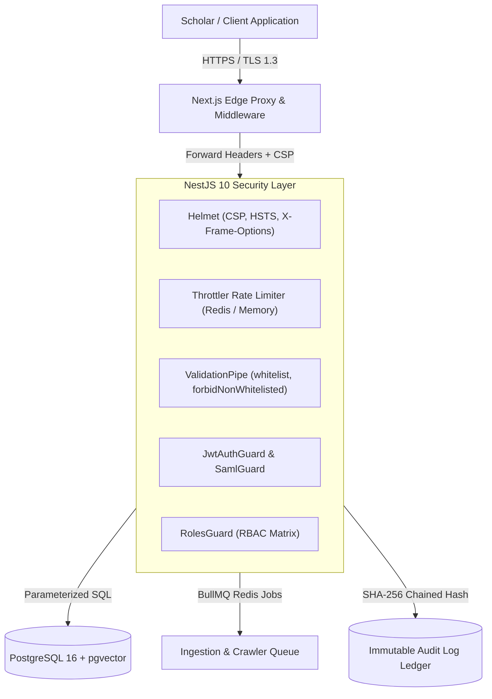

# Security Policy & Architecture (SECURITY.md)
## Cambium — AI-Powered Research Opportunity Discovery & Intelligence Platform
**The Enterprise Research Operating System**

---

### Metadata
- **Document ID**: `SEC-CAMBIUM-2026-V2`
- **Product Name**: Cambium Research Platform
- **Security Lead & Architect**: Shaik Mohamed Imthiyas T
- **Status**: `ENFORCED / PRODUCTION SECURITY BASELINE`
- **Current Version**: `2.0.0`
- **Standard Baseline**: OWASP Application Security Verification Standard (ASVS) Level 2
- **Traceability**: Implements security requirements from [`docs/templates/PRD.md`](file:///d:/01_PROJECTS/ACTIVE/S92_Imthiyas_Capstone_Cambium/docs/templates/PRD.md), [`docs/templates/ARCHITECTURE.md`](file:///d:/01_PROJECTS/ACTIVE/S92_Imthiyas_Capstone_Cambium/docs/templates/ARCHITECTURE.md), and [`AGENTS.md`](file:///d:/01_PROJECTS/ACTIVE/S92_Imthiyas_Capstone_Cambium/AGENTS.md)
- **Repository**: `S92_Imthiyas_Capstone_Cambium`

---

## 1. Security Architecture & Threat Model Overview

Cambium handles mission-critical scholarly assets: **unreleased preprints, proprietary grant budgets, multi-site human-subject ethics protocols (IRB), verified academic identity credentials, and research collaboration networks.**

Our security architecture enforces **Defense-in-Depth** across every tier:
1. **Zero-Trust Perimeter**: Every API request is strictly authenticated and validated. Internal micro-modules and controllers do not trust input implicitly.
2. **Cryptographic Non-Repudiation**: Sensitive operations (grant approvals, role elevations, IRB ethics reviews) generate immutable, SHA-256 chained audit logs in [`server/src/database/entities/audit-log.entity.ts`](file:///d:/01_PROJECTS/ACTIVE/S92_Imthiyas_Capstone_Cambium/server/src/database/entities/audit-log.entity.ts).
3. **Data Isolation & Tenant Boundaries**: Multi-role institutional boundaries prevent unauthorized cross-lab or student-to-PI data exposure.



---

## 2. Threat Analysis (STRIDE Model)

| Threat Category | Potential Attack Scenario | Impact | Implemented Mitigation & Safeguards | Code Reference |
| :--- | :--- | :--- | :--- | :--- |
| **Spoofing** | Attacker impersonates a PI to authorize an unapproved human trial or claim grant funds. | **Critical** | Cryptographic session verification; rotating JWTs with HTTP-only cookies; optional TOTP MFA; ORCID & SAML institutional federation. | [`server/src/modules/auth/`](file:///d:/01_PROJECTS/ACTIVE/S92_Imthiyas_Capstone_Cambium/server/src/modules/auth/) |
| **Tampering** | Malicious insider alters grant allocation numbers or tampers with IRB approval dates. | **High** | Append-only, SHA-256 chained audit ledger (`/audit`); database constraints; TypeORM immutable date triggers. | [`server/src/database/entities/audit-log.entity.ts`](file:///d:/01_PROJECTS/ACTIVE/S92_Imthiyas_Capstone_Cambium/server/src/database/entities/audit-log.entity.ts) |
| **Repudiation** | Co-author denies signing off on manuscript data or author role in CRediT matrix. | **Medium** | Immutable timestamped signature stored in PostgreSQL with actor user ID, client IP, and cryptographic hash. | [`server/src/modules/contributions/`](file:///d:/01_PROJECTS/ACTIVE/S92_Imthiyas_Capstone_Cambium/server/src/modules/contributions/) |
| **Information Disclosure** | Competitor scrapes unreleased draft preprints or embargoed grant applications. | **Critical** | Resource-level Access Control Lists (ACL); AES-256 at rest; pre-signed S3 URLs with 15-minute expirations; zero indexing of draft vectors in public search. | [`server/src/modules/upload/`](file:///d:/01_PROJECTS/ACTIVE/S92_Imthiyas_Capstone_Cambium/server/src/modules/upload/) |
| **Denial of Service** | Botnet floods the semantic search endpoint with massive vector calculation queries. | **High** | NestJS Throttler rate limiting (60 req/min per IP; 120 req/min per verified user); vector query caching. | [`server/src/app.module.ts`](file:///d:/01_PROJECTS/ACTIVE/S92_Imthiyas_Capstone_Cambium/server/src/app.module.ts) |
| **Elevation of Privilege** | Student researcher modifies lab GPU compute quotas or grants themselves PI privileges. | **Critical** | Strict NestJS `@Roles()` decorator guards; server-side role validation extracted directly from signed JWT claims. | [`server/src/common/guards/roles.guard.ts`](file:///d:/01_PROJECTS/ACTIVE/S92_Imthiyas_Capstone_Cambium/server/src/common/guards/roles.guard.ts) |

---

## 3. Authentication & Authorization Matrix

### 3.1 Token Lifecycle & Session Management
- **Access Tokens**: Short-lived (15 minutes), signed using HMAC-SHA256 with high-entropy secret (`JWT_SECRET`).
- **Refresh Tokens**: Long-lived (7 days), stored in an `HttpOnly`, `Secure`, `SameSite=Strict` cookie (`__Host-cambium_rf` or `refreshToken`).
- **Token Invalidation**: Refresh token rotation is mandatory; whenever a refresh token is used, a new one is issued and old tokens cannot be replayed.
- **Institutional SAML 2.0**: Supported via `@node-saml/passport-saml` in [`server/src/modules/auth/saml/saml.controller.ts`](file:///d:/01_PROJECTS/ACTIVE/S92_Imthiyas_Capstone_Cambium/server/src/modules/auth/saml/saml.controller.ts) for enterprise university identity providers (Shibboleth, Okta, Azure AD).

### 3.2 Role-Based Access Control (RBAC) Matrix

The system enforces five hierarchical user roles defined in [`server/src/modules/users/entities/user.entity.ts`](file:///d:/01_PROJECTS/ACTIVE/S92_Imthiyas_Capstone_Cambium/server/src/modules/users/entities/user.entity.ts):

| Platform Resource / Action | `Public` | `Fellow` (Student) | `Researcher` (Postdoc) | `PI` (Lab Director) | `ComplianceOfficer` (IRB/Auditor) | `Admin` |
| :--- | :---: | :---: | :---: | :---: | :---: | :---: |
| **Public Landing & /discover** | Read | Read | Read | Read | Read | Read |
| **Personal OS & Bookmarks** | ❌ | Read / Write (Own) | Read / Write (Own) | Read / Write (Own) | Read (Own) | Read / Write |
| **Agentic Reader (PDF Upload)** | ❌ | Read / Write (Own) | Read / Write (Own) | Read / Write (Own) | Read / Write (Own) | Read / Write |
| **Workspace & Projects** | ❌ | Read / Contributor | Read / Write | Admin (Own Lab) | Read-Only (Audit) | Full Admin |
| **Create Opportunity / Grant** | ❌ | ❌ | Request Review | **Create & Publish** | Verify & Flag | **Full Control** |
| **CRediT Contribution Claim** | ❌ | Submit Claim | Submit Claim | Endorse & Confirm | Audit Verify | Full Admin |
| **IRB Protocol Review** | ❌ | ❌ | Draft Protocol | Submit Protocol | **Approve / Reject** | Full Admin |
| **Security Audit Logs (`/audit`)**| ❌ | ❌ | Read Own Logs | Read Lab Logs | **Full Global Audit**| **Full Global Audit**|

---

## 4. Input Validation & Injection Prevention

### 4.1 SQL & Vector Injection Defense
- **Zero Raw String Concatenation**: All database interactions use TypeORM parameter binding (`queryBuilder.where("user.id = :id", { id })`).
- **Vector Sanitization**: High-dimensional vector inputs for `pgvector` are validated as 1536-element float arrays matching numerical boundaries before executing cosine distance queries.
- **Strict DTO Validation**: NestJS `ValidationPipe` is registered globally with:
  ```typescript
  new ValidationPipe({
    whitelist: true,
    forbidNonWhitelisted: true,
    transform: true,
  });
  ```

### 4.2 Cross-Site Scripting (XSS) & Content Security Policy (CSP)
- Next.js auto-escapes all JSX outputs.
- HTTP security headers enforced by NestJS Helmet and Next.js edge configuration:
  ```http
  Content-Security-Policy: default-src 'self'; script-src 'self' 'unsafe-eval' 'unsafe-inline' blob:; style-src 'self' 'unsafe-inline' https://fonts.googleapis.com blob:; font-src 'self' https://fonts.gstatic.com data:; img-src 'self' data: https: blob:; connect-src 'self' http://localhost:* http://127.0.0.1:* ws://localhost:* ws://127.0.0.1:* wss: https:; frame-ancestors 'none';
  X-Frame-Options: DENY
  X-Content-Type-Options: nosniff
  Referrer-Policy: strict-origin-when-cross-origin
  Permissions-Policy: camera=(), microphone=(), geolocation=(), interest-cohort=()
  ```

---

## 5. Cryptographic Audit Ledger & Integrity

Cambium maintains an immutable audit ledger ([`server/src/database/entities/audit-log.entity.ts`](file:///d:/01_PROJECTS/ACTIVE/S92_Imthiyas_Capstone_Cambium/server/src/database/entities/audit-log.entity.ts)) that records all critical security events:
1. Each audit log entry contains:
   - `id`: UUID primary key
   - `action`: Standard event descriptor (`AUTH_LOGIN`, `OPPORTUNITY_CREATE`, `ROLE_ELEVATION`, `CONTRIBUTION_ENDORSED`)
   - `actorId`: User ID of initiator
   - `targetId`: Resource ID acted upon
   - `metadata`: JSON payload of operation details
   - `previousHash`: Hex-encoded SHA-256 hash of previous block
   - `hash`: SHA-256 hash computed over `previousHash + action + actorId + timestamp + metadata`
2. Audit records cannot be modified or deleted via API endpoints.
3. Cryptographic integrity can be audited on-demand via `POST /api/audit/verify`.

---

## 6. Vulnerability Disclosure & Incident Reporting

If you discover a potential security vulnerability in Cambium, please adhere to responsible disclosure:
1. **Do not create public GitHub issues** for suspected zero-day vulnerabilities.
2. Email full reproduction steps and environment details to:
   - Security Team: `security@cambium.research`
   - Author / Lead Architect: Shaik Mohamed Imthiyas T (`shaik.imthiyas.t@gmail.com`)
3. The security team will acknowledge receipt within 24 hours and issue a patched release branch.
