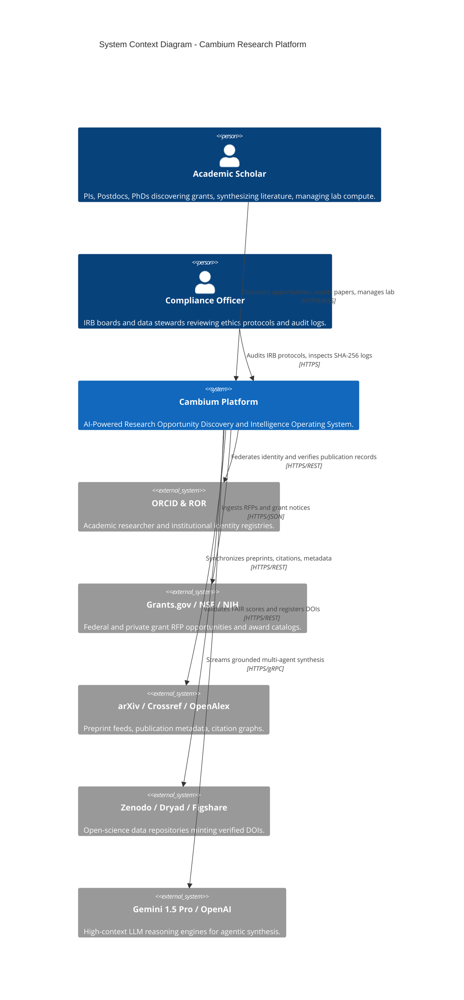
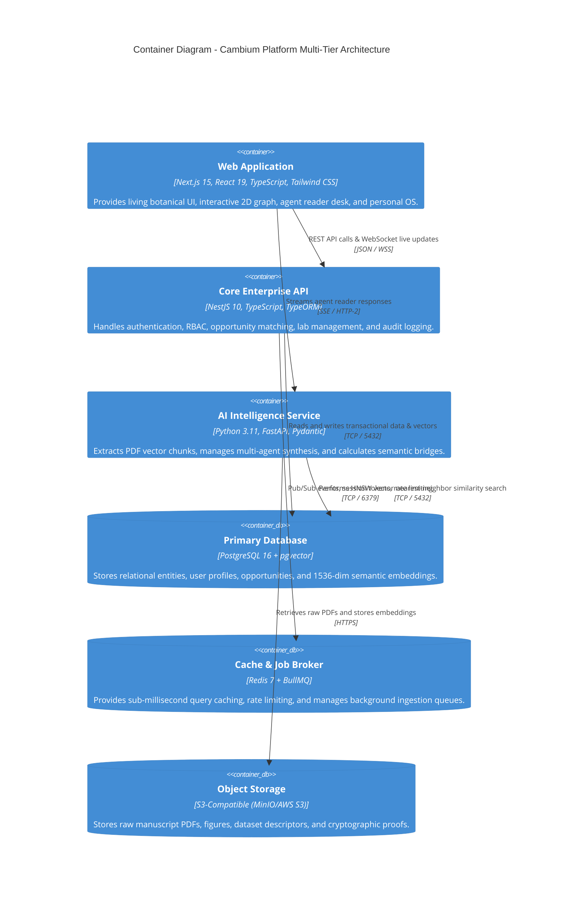
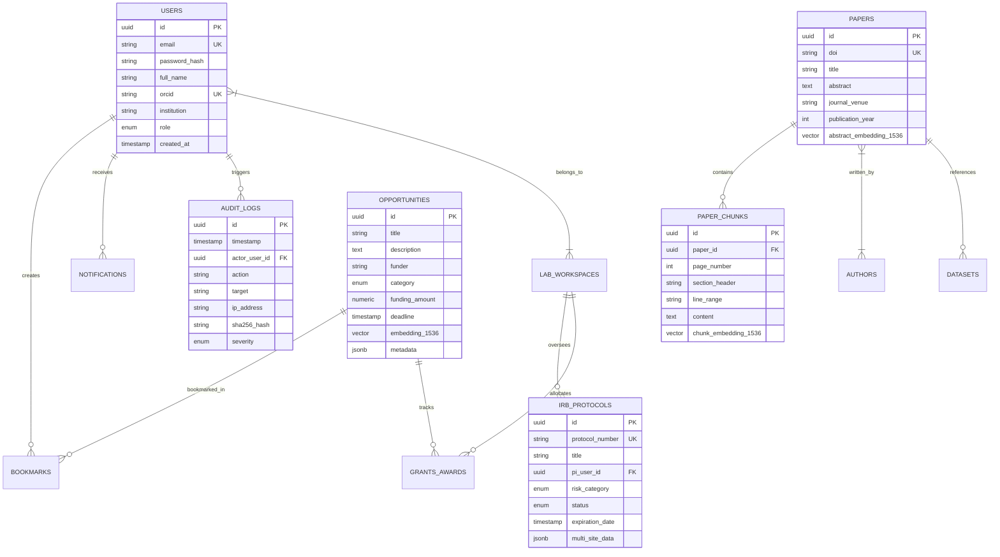
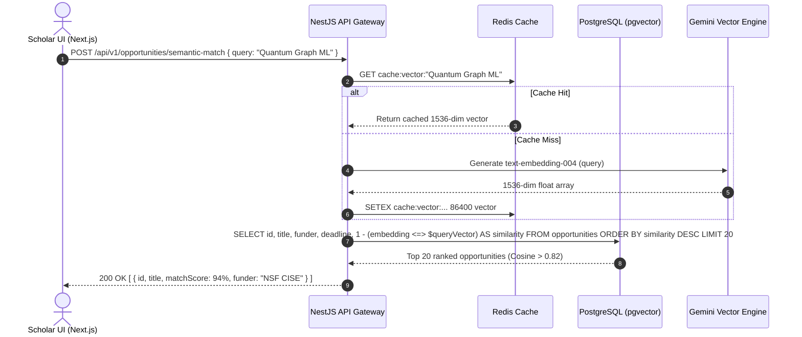

# System Architecture Document (ARCHITECTURE.md)
## Cambium — AI-Powered Research Opportunity Discovery & Intelligence Platform
**The Enterprise Research Operating System**

---

### Metadata
- **Document ID**: `ARCH-CAMBIUM-2026-V2`
- **Product Name**: Cambium Research Platform
- **Lead Architect**: Shaik Mohamed Imthiyas T
- **Status**: `APPROVED / ARCHITECTURAL BASELINE`
- **Current Version**: `2.0.0`
- **Traceability**: Implements requirements from [`docs/templates/PRD.md`](file:///d:/01_PROJECTS/ACTIVE/S92_Imthiyas_Capstone_Cambium/docs/templates/PRD.md)
- **Repository**: `S92_Imthiyas_Capstone_Cambium`

---

## 1. System Overview & Architectural Principles

Cambium is built on four core architectural principles:
1. **Biological Relational Topology**: Knowledge is modeled as a living graph rather than isolated documents. Grants, preprints, datasets, authors, and ethics protocols form interconnected nodes.
2. **Grounded Non-Hallucinatory AI**: All agentic reasoning layers must be grounded in physical PDF chunks down to the page, section, and line number (`L. 42–58`).
3. **Decoupled Asynchronous Resilience**: High-latency third-party academic crawlers (Crossref, arXiv, Grants.gov, Zenodo) are completely decoupled from user-facing queries via Redis and BullMQ job queues.
4. **Zero-Trust Institutional Security**: Every data access, ethics modification, and export event is cryptographically sealed in an append-only, SHA-256 hashed audit log.

---

## 2. C4 Model Architecture Views

### 2.1 C4 Level 1: System Context Diagram



---

### 2.2 C4 Level 2: Container Architecture Diagram



---

## 3. Technology Selection & Trade-Offs

| Component | Selected Technology | Evaluated Alternatives | Architectural Rationale & Trade-Offs |
| :--- | :--- | :--- | :--- |
| **Frontend Framework** | **Next.js 15 (App Router)** | Vite SPA, Remix | Next.js 15 enables hybrid SSR for public SEO (discoverability of preprints) paired with client-side state for deep interactive tools. Server Components minimize client bundle size. |
| **Backend Framework** | **NestJS 10 (TypeScript)** | Express, Fastify, Django | Enterprise modularity with dependency injection, strict TypeScript typing, out-of-the-box Swagger OpenAPI generation, and unified TypeORM integration. |
| **Primary Database & Vectors** | **PostgreSQL 16 + pgvector** | Pinecone, Milvus, MongoDB | Eliminates the two-database split-brain problem. Transactional relational data (grants, users, authors) lives in the exact same ACID store as vector embeddings, enabling atomic cross-table joins. |
| **Caching & Queue Worker** | **Redis 7 + BullMQ** | RabbitMQ, Kafka | In-memory latency (<1ms) for API rate limiting; BullMQ provides rock-solid job retries, priority queues, and scheduled cron jobs for grant deadline tracking. |
| **UI Design System** | **W3C Living Materials Tokens** | Plain Tailwind, Bootstrap | Fully audited WCAG 2.2 Level AA color tokens (`#202920`, `#FAF7F0`, `#3E6248`, `#4ADE80`) delivering a unique scholarly aesthetic while passing strict APCA perceptual readability standards. |

---

## 4. Database Entities & Relational Data Model

The primary PostgreSQL database (`cambium`) is strictly normalized (3NF) with vector extensions:



### 4.1 Vector Indexing Strategy
To guarantee sub-50ms search across hundreds of thousands of opportunity descriptions and paper chunks, embeddings are indexed using **HNSW (Hierarchical Navigable Small World)** in `pgvector`:
```sql
CREATE INDEX idx_opportunities_embedding_hnsw 
ON opportunities 
USING hnsw (embedding_1536 vector_cosine_ops) 
WITH (m = 16, ef_construction = 64);
```

---

## 5. API Contracts & Communication Boundaries

### 5.1 Primary REST Endpoints (OpenAPI / Swagger)
All endpoints follow RESTful conventions, return typed JSON, and validate requests via Zod / NestJS ValidationPipes:

- `POST /api/v1/auth/register` — Creates user, hashes password, issues dual JWT cookies.
- `POST /api/v1/auth/login` — Authenticates credentials, returns user profile + session tokens.
- `GET  /api/v1/opportunities` — Paginated opportunity discovery with multi-facet filtering.
- `POST /api/v1/opportunities/semantic-match` — Takes a user's research vector and returns ranked opportunities with cosine similarity match scores (0–100%).
- `GET  /api/v1/graph/nodes` — Fetches 2D constellation graph topology with calculated structural bridges.
- `POST /api/v1/agent-reader/audit` — Invokes specialized agent personas (*Methodology Auditor*, *Statistical Rigor*) on indexed manuscript chunks.
- `GET  /api/v1/compliance/protocols` — Fetches institutional IRB protocols and amendment statuses.
- `POST /api/v1/data-management/fair-evaluate` — Calculates FAIR compliance score (0–100) and syncs with Zenodo API.
- `GET  /api/v1/audit/logs` — Streams append-only SHA-256 audit log records (restricted to Compliance Officers and PIs).

---

## 6. Critical Request Sequences

### 6.1 Semantic Opportunity Matching Flow



---

## 7. Authentication & Authorization Boundaries

```
[ Public Zone: Landing Page, /discover, /terms ]
       │
       ▼ (Bearer JWT / HttpOnly Cookie Validation)
[ Authenticated Perimeter: /dashboard, /workspace, /os, /graph ]
       │
       ├─► Role: 'Researcher' / 'Fellow'
       │     └─► Read/Write Own Workspace, Bookmarks, Agentic Reader
       │
       ├─► Role: 'Principal Investigator (PI)'
       │     └─► Full Lab Workspace, Grant Budgets, IRB Submissions, Team Roster
       │
       └─► Role: 'ComplianceOfficer' / 'Auditor'
             └─► Global IRB Protocol Approvals, Immutable SHA-256 Logs, Data Export Audits
```

---

## 8. Architectural Decision Records (ADRs)

### ADR-001: Decoupled Monorepo Architecture
- **Status**: Accepted
- **Context**: The product requires rapid unified development of a Next.js frontend and NestJS backend.
- **Decision**: Organize repository as a root npm monorepo with `client/` and `server/` packages sharing design tokens in `tokens/`.
- **Consequences**: Single git history; simplified CI/CD; isolated build scripts.

### ADR-002: PostgreSQL + pgvector for Hybrid Search
- **Status**: Accepted
- **Context**: Evaluating standalone vector databases (Pinecone, Weaviate) vs. PostgreSQL extensions.
- **Decision**: Standardize on `pgvector` inside PostgreSQL 16.
- **Consequences**: Atomic relational joins between vector similarity scores and operational filters (e.g. `WHERE deadline > NOW() AND category = 'grant'`); zero network hop to third-party vector SaaS; reduced infrastructure cost.

### ADR-003: Asynchronous Ingestion via Redis BullMQ
- **Status**: Accepted
- **Context**: Academic metadata aggregators (Grants.gov, arXiv) exhibit rate limits and intermittent timeouts.
- **Decision**: Route all external sync through BullMQ priority queues with exponential backoff and jitter.
- **Consequences**: Zero user request blocking; reliable background retries; graceful handling of funder downtime.

### ADR-004: W3C DTCG Token Specification for Visual Design
- **Status**: Accepted
- **Context**: Visual identity requires dark botanical elegance while strictly guaranteeing WCAG 2.2 AA accessibility.
- **Decision**: Define tokens in `tokens/cambium.tokens.json` adhering to W3C DTCG format and export to CSS variables.
- **Consequences**: High-contrast compliance guaranteed; unified styling across both web app and SVG visualizations.

### ADR-005: Line-Level Grounding for Scientific AI
- **Status**: Accepted
- **Context**: Generic LLM summaries hallucinate mathematical derivations and scientific citations.
- **Decision**: Mandate chunk-level coordinate tracking (`page_number`, `line_range`) on all ingested PDFs. Refuse synthesis unless supported by physical document spans.
- **Consequences**: Zero-hallucination guarantee; high credibility with peer reviewers and research faculty.
